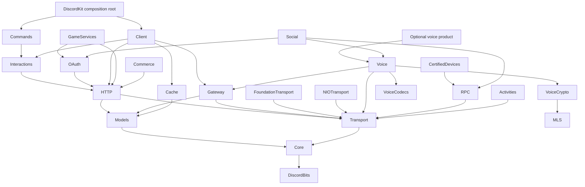

# DiscordKit: a multipart implementation roadmap

## 1. Goal

Build a modular, Swift-native Discord application and bot SDK designed for deployments serving hundreds through millions of Discord accounts, with typed coverage of every available, documented operation across the requested Discord developer platform, efficient requests, early sharding, measured resource budgets, automatic protocol management and versioned parity maintenance.

## 2. Approach

Use small Swift Package Manager targets with immutable Sendable models, partitioned actor-owned runtime state, structured task lifetimes, and bounded AsyncSequence subscriptions. Build working HTTP and sharded Gateway slices early with coordinated rate admission, request reduction, aggregate resource budgets and load evidence, then expand through independently verifiable work packages driven by the reviewed parity inventory. Preserve a straightforward DiscordKit entry point while allowing REST, HTTP interactions, Gateway, OAuth2, and voice to be adopted independently, with optional external coordination for fleets.

### Scope and verified baseline

Research date: **2026-10-15**. Protocol versions are separate: explicitly use REST v10, Gateway v10, and Voice Gateway v8 under the current documentation, and reverify before implementation. Never silently choose Discord's unversioned default. [API versioning](https://docs.discord.com/developers/reference#api-versioning), [Gateway](https://docs.discord.com/developers/events/gateway), [Voice](https://docs.discord.com/developers/topics/voice-connections).

**Application/bot provisioning:** Discord's documented setup starts in the Developer Portal; newly registered applications already have bot users. DiscordKit will operate those applications and implement public configuration/install/authentication APIs, but will not invent a public application-creation or bot-token-provisioning endpoint. Document these setup steps in the onboarding guide. Provisional game-user accounts are a different, documented backend feature. [Bot setup](https://docs.discord.com/developers/quick-start/getting-started), [Application API](https://docs.discord.com/developers/resources/application), [Provisional accounts](https://docs.discord.com/developers/discord-social-sdk/development-guides/provisional-accounts/bot-token-endpoint).

### Confirmed scope choices

- **Platforms:** all Swift platforms. Qualify macOS, Linux, Windows, iOS, tvOS, watchOS, visionOS and Android; track WASI/browser/Embedded and experimental targets by actual supported capabilities.
- **Dependencies:** Apple-origin official Swift package families and their normal maintained transitive/bundled implementations are permitted. This includes the upstream code normally shipped by approved Apple packages; it does not authorize adding Discord's native SDK.
- **Feature scope:** the entire developer platform, including backend APIs, bot/Gateway, voice/media, OAuth2, local RPC, certified devices, Activities/Embedded APIs, Social SDK capabilities and commerce.
- **Deliverable:** one master roadmap with separately implementable parts and explicit dependencies/completion gates.
- **Scale:** serve hundreds through millions of Discord accounts across a deployment, including services with many bot/application identities. Track end users, credentials, guilds, shards, active sessions and concurrent requests separately; no single-process or live-connection capacity is implied by the account target.

### Scalability requirements added 2026-10-15

The adopted [Scalability.md](../../Docs/Scalability.md) is the detailed capacity, request-efficiency, coordination and verification contract for every runtime part. This addition extends the roadmap; completed Part 1 foundations do not implement rate admission, caches or sharded sessions.

- Partition ownership by identity/resource/shard; bound both per-partition and aggregate queues, bytes, tasks, connections, caches, in-flight reads and metadata. Share rate authorities across clients/workers using the same credential, preserve applicable shared-resource/egress limits, and define fairness and coordinator-outage behavior.
- Reduce requests with eligible-read coalescing, explicit HTTP freshness policies, bounded entity projections, useful event payload data, lazy pagination and documented endpoint-specific bulk helpers. Keep identity/permission isolation, ordering, cancellation, partial results and ambiguous mutation outcomes intact.
- Design shard routing/subsets, ownership and startup budgets during Parts 0–2. Start Part 6's minimal multi-shard lifecycle alongside Part 3; it does not wait for the full REST catalog, cache or consumer framework. Distributed adapters remain optional and pass common coordination contract tests.
- Start a separate local load harness in Part 2, extend it at each runtime milestone, and record numeric budgets and baselines before claiming capacity. Simulate 100/10,000/1,000,000 logical accounts in bounded active cohorts; separately measure real local sockets/concurrency. Report throughput, tail latency, CPU/RSS, request reduction and failure recovery without load-testing Discord.

**A real constraint on final completion:** some Social SDK and early-access commerce features have published product interfaces but no complete public wire contract. Implement all documented equivalents locally and retain those remaining capabilities as explicit blockers; do not omit them, invent their protocol, or call a stub parity. Under the approved dependency rule, a wrapper around Discord's distributed runtime is not an implementation option. [Native SDK setup](https://docs.discord.com/developers/discord-social-sdk/getting-started/using-c%2B%2B), [Commerce availability](https://docs.discord.com/developers/social-commerce/overview).

A second boundary is platform execution: the package can expose portable types and capability-aware APIs everywhere, but OS policy and Discord host availability determine which operations can run on each platform. Full cross-platform support must report these distinctions rather than promising identical runtime behavior.

“Full parity” means that every inventoried available operation, model field, event, opcode, permission, intent, and relevant protocol behavior has a typed implementation, accurate documentation, and linked verification evidence. Raw JSON/route escape hatches improve forward access but do not count as typed parity. Approved/gated operations remain in scope with their prerequisites; unavailable, removed, portal-only, and SDK-only entries remain explicitly classified.

Discord changes within API versions. This roadmap fixes an explicit feature boundary and maintenance mechanism; it cannot freeze upstream behavior or guarantee that future Discord features will require no new work.

### Existing repository and preservation requirements

Current state after Part 1, reviewed 2026-10-15:

- [Package.swift](air-file://l5n6o8gm5adj032jrr52/Users/carsonrau/Developer/DiscordKit/Package.swift?type=file&root=%252F) requires Swift 6.4, enables ApproachableConcurrency and explicitly selects nonisolated default isolation for every root target. Preserve these settings and four-space indentation across new targets.
- [DiscordKit.swift](air-file://l5n6o8gm5adj032jrr52/Users/carsonrau/Developer/DiscordKit/Sources/DiscordKit/DiscordKit.swift?type=file&root=%252F) exposes common Core aliases; [DiscordKitTests.swift](air-file://l5n6o8gm5adj032jrr52/Users/carsonrau/Developer/DiscordKit/Tests/DiscordKitTests/DiscordKitTests.swift?type=file&root=%252F) exercises portable consumer behavior and MainActor adoption. Part 1 replaced the original hello() and empty test scaffold. Extend these foundations with composition when implemented runtime products exist.
- [AGENTS.md](air-file://l5n6o8gm5adj032jrr52/Users/carsonrau/Developer/DiscordKit/AGENTS.md?type=file&root=%252F) already describes the implemented sublibraries, deterministic test support and separate feasibility/tooling packages. Preserve their dependency boundaries and update guidance with each implemented phase. Inspect the working tree again before each change; a previous clean snapshot does not establish current state.
- Keep generated outputs and local metadata consistent with [.gitignore](air-file://l5n6o8gm5adj032jrr52/Users/carsonrau/Developer/DiscordKit/.gitignore?type=file&root=%252F); reviewed generated source belongs in version control, build products and credentials do not.

### Dependency policy

Allow only approved Apple-origin/official Swift-project package families under the chosen dependency interpretation. Add each package when used, with a recorded purpose, compatible version range, license/provenance, platform/toolchain compatibility, transitive graph, and verified release date. Never vendor a disallowed package into an “owned” folder to bypass the rule.

Verified candidate releases, not an instruction to install all of them:

| Package | Verified release | Intended role |
|---|---:|---|
| [swift-collections](https://github.com/apple/swift-collections/releases/tag/1.7.3) | 1.7.3 | Bounded queues and ordered collections |
| [swift-async-algorithms](https://github.com/apple/swift-async-algorithms/releases/tag/1.1.7) | 1.1.7 | Stable sequence/channel algorithms where useful |
| [swift-http-types](https://github.com/apple/swift-http-types/releases/tag/1.8.0) | 1.8.0 | Shared HTTP value types |
| [swift-log](https://github.com/apple/swift-log/releases/tag/1.16.0) | 1.16.0 | Consumer-configured logging |
| [swift-crypto](https://github.com/apple/swift-crypto/releases/tag/5.0.1) | 5.0.1 | Ed25519, hashes and supported AEAD primitives |
| [swift-nio](https://github.com/apple/swift-nio/releases/tag/2.104.0) | 2.104.0 | Locally written WebSocket, UDP and server adapters |
| [swift-nio-ssl](https://github.com/apple/swift-nio-ssl/releases/tag/2.37.5) | 2.37.5 | Linux/cross-platform TLS adapter |
| [swift-system](https://github.com/apple/swift-system/releases/tag/1.8.1) | 1.8.1 | Low-level system access if needed |
| [swift-docc-plugin](https://github.com/swiftlang/swift-docc-plugin/releases/tag/1.5.0) | 1.5.0 | Development-only DocC tooling |
| [swift-syntax](https://github.com/swiftlang/swift-syntax/releases/tag/604.0.0) | 604.0.0 | Development-only declaration/documentation checks |

Use compatible lower bounds and next-major upper bounds for ordinary libraries; align SwiftSyntax with the toolchain. Reverify releases before each addition. Audit the complete graph and avoid experimental APIs such as AsyncAlgorithms' unstable streaming trait. Standard library/Foundation/CryptoKit/system networking are platform facilities, not new third-party package dependencies.

### Module boundaries

Arrow direction means “depends on.” Introduce targets only with real code; optional targets never become prerequisites of the REST-only product.



Transport adapters are injected at the composition root. Gateway does not import cache, Commands does not import Client, and Voice depends on narrow Gateway control protocols rather than the facade. Put protocols in the lowest module that already knows their parameter types. Models contain no live client or transport references. Use product separation rather than mutually exclusive SwiftPM traits.

### Consumer contract

- REST-only users call async services directly; they need no Gateway session.
- Normal bot users configure credentials, intents, handlers and policy, then await a supervised run operation. Heartbeats, discovery, reconnect/resume, rate-limit scheduling, serialization and socket ownership are internal.
- HTTP-only applications can validate and handle interactions without loading Gateway or Voice.
- Command builders and routers are conveniences over the complete typed API. They cannot hide supported fields or prevent raw typed request construction.
- Voice users join, send/receive frames and leave through an optional module; they do not maintain the voice heartbeat, UDP discovery, encryption, or RTP sequence counters.
- Expose explicit status, errors and diagnostic hooks without requiring consumers to operate protocol internals.


## 3. File changes

Existing files to modify:

| Action | Existing file | Responsibility |
|---|---|---|
| Modify | [Package.swift](air-file://l5n6o8gm5adj032jrr52/Users/carsonrau/Developer/DiscordKit/Package.swift?type=file&root=%252F) | Incremental target/product graph, platforms, approved dependencies, resources and uniform concurrency settings |
| Modify | [DiscordKit.swift](air-file://l5n6o8gm5adj032jrr52/Users/carsonrau/Developer/DiscordKit/Sources/DiscordKit/DiscordKit.swift?type=file&root=%252F) | Extend the implemented foundational aliases with composition and deliberate public entry points |
| Modify | [DiscordKitTests.swift](air-file://l5n6o8gm5adj032jrr52/Users/carsonrau/Developer/DiscordKit/Tests/DiscordKitTests/DiscordKitTests.swift?type=file&root=%252F) | Extend the implemented portable consumer tests with runtime consumer-contract tests |
| Modify | [AGENTS.md](air-file://l5n6o8gm5adj032jrr52/Users/carsonrau/Developer/DiscordKit/AGENTS.md?type=file&root=%252F) | Describe the authorized modular layout and actual validation commands; preserve the existing method documentation/testing rules |
| Modify as needed | [.gitignore](air-file://l5n6o8gm5adj032jrr52/Users/carsonrau/Developer/DiscordKit/.gitignore?type=file&root=%252F) | Ignore new tool caches and local integration credentials only |

The following is a **creation specification**, not a list of files that already exist. All locations are relative to the existing [DiscordKit repository](air-folder://l5n6o8gm5adj032jrr52/Users/carsonrau/Developer/DiscordKit?type=folder&root=%252F). Each listed location is **Create**. Group identifiers are used throughout the implementation steps to refer to these exact locations without duplicating the manifest.

**F00 — architecture, policy, inventory, and chronological history**

```text
README.md
CHANGELOG.md
CONTRIBUTING.md
Docs/Architecture.md
Docs/Foundation.md
Docs/Concurrency.md
Docs/Scalability.md
Docs/Dependencies.md
Docs/PlatformSupport.md
Docs/Parity/README.md
Docs/Parity/inventory.schema.json
Docs/Parity/inventory-v1.json
Docs/Parity/sources-2026-10-15.json
Docs/Parity/ambiguities.json
Docs/Parity/history.json
Docs/Parity/coverage.md
Docs/Parity/changes/2026-10-15-baseline.md
```

**F01 — portable values and foundational protocols**

```text
Sources/DiscordBits/UnsignedBitSet.swift
Sources/DiscordCore/Snowflake.swift
Sources/DiscordCore/JSONValue.swift
Sources/DiscordCore/Field.swift
Sources/DiscordCore/RawValue.swift
Sources/DiscordCore/DiscordTimestamp.swift
Sources/DiscordCore/Credentials.swift
Sources/DiscordCore/DiscordError.swift
Sources/DiscordCore/Capabilities.swift
Sources/DiscordCore/Redaction.swift
Sources/DiscordTransport/HTTPTransport.swift
Sources/DiscordTransport/WebSocketTransport.swift
Sources/DiscordTransport/DatagramTransport.swift
Sources/DiscordTransport/IPCTransport.swift
Sources/DiscordTransport/HTTPIngress.swift
Sources/DiscordTransport/BodyStream.swift
Sources/DiscordTransport/Lifecycle.swift
```

**F02 — owned network and platform adapters**

```text
Sources/DiscordFoundationTransport/FoundationHTTPTransport.swift
Sources/DiscordFoundationTransport/FoundationWebSocketTransport.swift
Sources/DiscordNIOTransport/NIOHTTPTransport.swift
Sources/DiscordNIOTransport/NIOWebSocketTransport.swift
Sources/DiscordNIOTransport/NIODatagramTransport.swift
Sources/DiscordNIOTransport/NIOHTTPIngress.swift
Sources/DiscordNIOTransport/TLSPolicy.swift
Sources/DiscordApplePlatform/AppleLifecycle.swift
Sources/DiscordApplePlatform/AppleAuthentication.swift
Sources/DiscordApplePlatform/AppleWebBridge.swift
Sources/DiscordApplePlatform/AppleAudio.swift
Sources/DiscordApplePlatform/AppleVideo.swift
Sources/DiscordWindowsPlatform/WindowsIPC.swift
Sources/DiscordWindowsPlatform/WindowsAudio.swift
Sources/DiscordWindowsPlatform/WindowsVideo.swift
Sources/DiscordAndroidPlatform/AndroidPlatform.swift
Sources/CDiscordAndroidPlatform/include/DiscordAndroidPlatform.h
Sources/CDiscordAndroidPlatform/DiscordAndroidPlatform.c
Sources/DiscordUnixPlatform/UnixIPC.swift
```

Share NIO across qualified operating systems. Only if the early Windows qualification finds a reproducible unresolved transport gap, add a separately documented **Create** fallback: Sources/DiscordWindowsPlatform/WindowsNetwork.swift. Do not preemptively write a second networking stack.

**F03 — HTTP execution, authentication policy and scheduling**

```text
Sources/DiscordHTTP/Endpoint.swift
Sources/DiscordHTTP/RESTClient.swift
Sources/DiscordHTTP/RequestEncoder.swift
Sources/DiscordHTTP/ResponseDecoder.swift
Sources/DiscordHTTP/MultipartBody.swift
Sources/DiscordHTTP/RateLimitCoordinator.swift
Sources/DiscordHTTP/RateLimitStore.swift
Sources/DiscordHTTP/SchedulingPolicy.swift
Sources/DiscordHTTP/RequestCoalescer.swift
Sources/DiscordHTTP/ReadCache.swift
Sources/DiscordHTTP/RetryPolicy.swift
Sources/DiscordHTTP/Pagination.swift
Sources/DiscordHTTP/RawEndpoint.swift
Sources/DiscordHTTP/AssetClient.swift
```

**F04 — complete typed resource catalog**

Create each exact pair below. The first file holds that family's models and typed request/response payloads; the second holds its endpoint descriptors and services. Both are generated from reviewed definitions where possible, with explicit semantic overlays.

```text
Sources/DiscordModels/Application.swift
Sources/DiscordHTTP/Resources/ApplicationEndpoints.swift
Sources/DiscordModels/ApplicationIdentityProfile.swift
Sources/DiscordHTTP/Resources/ApplicationIdentityProfileEndpoints.swift
Sources/DiscordModels/ApplicationRoleConnectionMetadata.swift
Sources/DiscordHTTP/Resources/ApplicationRoleConnectionMetadataEndpoints.swift
Sources/DiscordModels/AuditLog.swift
Sources/DiscordHTTP/Resources/AuditLogEndpoints.swift
Sources/DiscordModels/AutoModeration.swift
Sources/DiscordHTTP/Resources/AutoModerationEndpoints.swift
Sources/DiscordModels/Channel.swift
Sources/DiscordHTTP/Resources/ChannelEndpoints.swift
Sources/DiscordModels/Emoji.swift
Sources/DiscordHTTP/Resources/EmojiEndpoints.swift
Sources/DiscordModels/Entitlement.swift
Sources/DiscordHTTP/Resources/EntitlementEndpoints.swift
Sources/DiscordModels/Guild.swift
Sources/DiscordHTTP/Resources/GuildEndpoints.swift
Sources/DiscordModels/GuildScheduledEvent.swift
Sources/DiscordHTTP/Resources/GuildScheduledEventEndpoints.swift
Sources/DiscordModels/GuildTemplate.swift
Sources/DiscordHTTP/Resources/GuildTemplateEndpoints.swift
Sources/DiscordModels/Invite.swift
Sources/DiscordHTTP/Resources/InviteEndpoints.swift
Sources/DiscordModels/Lobby.swift
Sources/DiscordHTTP/Resources/LobbyEndpoints.swift
Sources/DiscordModels/Message.swift
Sources/DiscordHTTP/Resources/MessageEndpoints.swift
Sources/DiscordModels/Poll.swift
Sources/DiscordHTTP/Resources/PollEndpoints.swift
Sources/DiscordModels/SKU.swift
Sources/DiscordHTTP/Resources/SKUEndpoints.swift
Sources/DiscordModels/Soundboard.swift
Sources/DiscordHTTP/Resources/SoundboardEndpoints.swift
Sources/DiscordModels/StageInstance.swift
Sources/DiscordHTTP/Resources/StageInstanceEndpoints.swift
Sources/DiscordModels/Sticker.swift
Sources/DiscordHTTP/Resources/StickerEndpoints.swift
Sources/DiscordModels/Subscription.swift
Sources/DiscordHTTP/Resources/SubscriptionEndpoints.swift
Sources/DiscordModels/User.swift
Sources/DiscordHTTP/Resources/UserEndpoints.swift
Sources/DiscordModels/Voice.swift
Sources/DiscordHTTP/Resources/VoiceEndpoints.swift
Sources/DiscordModels/Webhook.swift
Sources/DiscordHTTP/Resources/WebhookEndpoints.swift
Sources/DiscordModels/Permissions.swift
Sources/DiscordModels/ApplicationCommand.swift
Sources/DiscordModels/Component.swift
Sources/DiscordModels/Interaction.swift
Sources/DiscordModels/GatewayEvent.swift
Sources/DiscordModels/WebhookEvent.swift
Sources/DiscordHTTP/Resources/ApplicationCommandEndpoints.swift
Sources/DiscordHTTP/Resources/InteractionEndpoints.swift
```

**F05 — Gateway, dispatch and cache**

```text
Sources/DiscordGateway/GatewayEnvelope.swift
Sources/DiscordGateway/GatewayStateMachine.swift
Sources/DiscordGateway/GatewayShard.swift
Sources/DiscordGateway/HeartbeatController.swift
Sources/DiscordGateway/ShardCoordinator.swift
Sources/DiscordGateway/ShardLeaseStore.swift
Sources/DiscordGateway/SessionStartCoordinator.swift
Sources/DiscordGateway/GatewayRequests.swift
Sources/DiscordGateway/EventHub.swift
Sources/DiscordCache/CachePolicy.swift
Sources/DiscordCache/DiscordCache.swift
Sources/DiscordCache/EventReducer.swift
Sources/DiscordCache/PermissionResolver.swift
```

**F06 — interactions, commands and bot composition**

```text
Sources/DiscordInteractions/SignatureVerifier.swift
Sources/DiscordInteractions/InteractionReceiver.swift
Sources/DiscordInteractions/InteractionResponder.swift
Sources/DiscordInteractions/WebhookEventReceiver.swift
Sources/DiscordInteractions/AdmissionPolicy.swift
Sources/DiscordCommands/CommandDefinition.swift
Sources/DiscordCommands/CommandRouter.swift
Sources/DiscordCommands/CommandReconciler.swift
Sources/DiscordCommands/ComponentRouter.swift
Sources/DiscordClient/DiscordClient.swift
Sources/DiscordClient/ClientConfiguration.swift
Sources/DiscordClient/ClientRuntime.swift
Sources/DiscordClient/ServiceContext.swift
Sources/DiscordClient/Diagnostics.swift
```

**F07 — OAuth2 and game/backend services**

```text
Sources/DiscordOAuth/OAuthClient.swift
Sources/DiscordOAuth/AuthorizationFlow.swift
Sources/DiscordOAuth/TokenCoordinator.swift
Sources/DiscordGameServices/ProvisionalAccounts.swift
Sources/DiscordGameServices/AccountLinking.swift
Sources/DiscordGameServices/PublisherLinking.swift
Sources/DiscordGameServices/GameProfiles.swift
Sources/DiscordGameServices/LinkedLobbies.swift
Sources/DiscordCommerce/CommerceClient.swift
Sources/DiscordCommerce/EntitlementService.swift
```

**F08 — desktop RPC, certified devices, Activities and Social**

```text
Sources/DiscordRPC/RPCFrame.swift
Sources/DiscordRPC/RPCClient.swift
Sources/DiscordRPC/RPCCommands.swift
Sources/DiscordRPC/RPCEvents.swift
Sources/DiscordCertifiedDevices/CertifiedDevice.swift
Sources/DiscordCertifiedDevices/DevicePublisher.swift
Sources/DiscordActivities/ActivityClient.swift
Sources/DiscordActivities/ActivityCommands.swift
Sources/DiscordActivities/ActivityEvents.swift
Sources/DiscordActivities/ActivityHostTransport.swift
Sources/DiscordActivities/URLMapping.swift
Web/DiscordActivityBridge/bridge.js
Web/DiscordActivityBridge/bridge.test.js
Sources/DiscordSocial/SocialClient.swift
Sources/DiscordSocial/SocialProvider.swift
Sources/DiscordSocial/SocialModels.swift
Sources/DiscordSocial/RelationshipStore.swift
Sources/DiscordSocial/SocialCall.swift
```

The browser bridge is locally authored JavaScript with no npm runtime dependency. It is required for the actual Activity iframe contract; a native Swift object alone cannot communicate as an iframe. Swift/browser bindings are adapters to that bridge, qualified per host.

**F09 — media, voice cryptography, codecs and sessions**

```text
Sources/DiscordMedia/MediaFrame.swift
Sources/DiscordMedia/AudioSource.swift
Sources/DiscordMedia/AudioProcessing.swift
Sources/DiscordMedia/Resampler.swift
Sources/DiscordMedia/AudioMixer.swift
Sources/DiscordMedia/EchoCanceller.swift
Sources/DiscordMedia/NoiseSuppressor.swift
Sources/DiscordMedia/VoiceActivityDetector.swift
Sources/DiscordMedia/VideoSource.swift
Sources/DiscordMedia/MediaClock.swift
Sources/DiscordVoiceCodecs/OpusEncoder.swift
Sources/DiscordVoiceCodecs/OpusDecoder.swift
Sources/DiscordVoiceCodecs/OpusBitstream.swift
Sources/DiscordVoiceCodecs/OpusRangeCoder.swift
Sources/DiscordVoiceCodecs/SILKCodec.swift
Sources/DiscordVoiceCodecs/CELTCodec.swift
Sources/DiscordVoiceCodecs/HybridCodec.swift
Sources/DiscordVideoCodecs/VideoCodec.swift
Sources/DiscordVideoCodecs/CodecCapability.swift
Sources/DiscordVoiceCrypto/TransportAEAD.swift
Sources/DiscordVoiceCrypto/MediaAEAD.swift
Sources/DiscordVoiceCrypto/XChaCha20Poly1305.swift
Sources/DiscordVoiceCrypto/TruncatedAESGCM.swift
Sources/DiscordMLS/MLSCodec.swift
Sources/DiscordMLS/MLSKeySchedule.swift
Sources/DiscordMLS/MLSCredentials.swift
Sources/DiscordMLS/MLSTree.swift
Sources/DiscordMLS/MLSCrypto.swift
Sources/DiscordMLS/MLSGroup.swift
Sources/DiscordDAVE/DAVESession.swift
Sources/DiscordDAVE/DAVEFrameTransform.swift
Sources/DiscordVoice/VoiceStateMachine.swift
Sources/DiscordVoice/VoiceSession.swift
Sources/DiscordVoice/VoiceGateway.swift
Sources/DiscordVoice/RTPPacket.swift
Sources/DiscordVoice/JitterBuffer.swift
Sources/DiscordVoice/MediaPipeline.swift
Sources/DiscordVoice/VoiceManager.swift
```

VideoCodec defines owned codec/provider contracts, not a claim that every codec has been implemented. Concrete portable or platform encoders/decoders are added only for capabilities whose public signaling and negotiated media requirements are established in Part 12; each becomes its own explicit work package and inventory record. This is a protocol-evidence gate, not permission to remove video from scope.

**F10 — reusable deterministic test support and feature suites**

```text
Tests/DiscordTestSupport/ManualClock.swift
Tests/DiscordTestSupport/SeededRandom.swift
Tests/DiscordTestSupport/ScriptedTransports.swift
Tests/DiscordTestSupport/ResourceTracker.swift
Tests/DiscordTestSupport/Barrier.swift
Tests/DiscordTestSupport/ScriptedIngress.swift
Tests/DiscordTestSupport/FixtureLoader.swift
Tests/DiscordBitsTests/UnsignedBitSetTests.swift
Tests/DiscordCoreTests/CoreValueTests.swift
Tests/DiscordCoreTests/JSONValueTests.swift
Tests/DiscordCoreTests/FieldTests.swift
Tests/DiscordCoreTests/RawValueTests.swift
Tests/DiscordCoreTests/DiscordTimestampTests.swift
Tests/DiscordCoreTests/SnowflakeCredentialTests.swift
Tests/DiscordCoreTests/RedactionCapabilityTests.swift
Tests/DiscordTransportTests/TransportContractTests.swift
Tests/DiscordTestSupportTests/TestSupportTests.swift
Tests/DiscordTestSupportTests/ScriptedTransportTests.swift
Tests/DiscordTestSupportTests/ScriptedIngressTests.swift
Tests/DiscordHTTPTests/HTTPPipelineTests.swift
Tests/DiscordHTTPTests/RateLimitCoordinationTests.swift
Tests/DiscordHTTPTests/RequestEfficiencyTests.swift
Tests/DiscordHTTPTests/ResourceParityTests.swift
Tests/DiscordModelsTests/ModelParityTests.swift
Tests/DiscordGatewayTests/GatewayLifecycleTests.swift
Tests/DiscordGatewayTests/ShardingTests.swift
Tests/DiscordGatewayTests/ShardOwnershipTests.swift
Tests/DiscordGatewayTests/EventDeliveryTests.swift
Tests/DiscordCacheTests/CacheTests.swift
Tests/DiscordInteractionsTests/InteractionTests.swift
Tests/DiscordInteractionsTests/WebhookEventTests.swift
Tests/DiscordCommandsTests/CommandTests.swift
Tests/DiscordClientTests/ClientLifecycleTests.swift
Tests/DiscordOAuthTests/OAuthTests.swift
Tests/DiscordGameServicesTests/GameServicesTests.swift
Tests/DiscordCommerceTests/CommerceTests.swift
Tests/DiscordRPCTests/RPCTests.swift
Tests/DiscordCertifiedDevicesTests/DeviceTests.swift
Tests/DiscordActivitiesTests/ActivityTests.swift
Tests/DiscordSocialTests/SocialTests.swift
Tests/DiscordMediaTests/MediaTests.swift
Tests/DiscordVoiceCodecsTests/OpusConformanceTests.swift
Tests/DiscordVideoCodecsTests/VideoCodecTests.swift
Tests/DiscordVoiceCryptoTests/AEADTests.swift
Tests/DiscordMLSTests/MLSTests.swift
Tests/DiscordDAVETests/DAVETests.swift
Tests/DiscordVoiceTests/VoiceLifecycleTests.swift
Tests/DiscordPlatformTests/PlatformAdapterTests.swift
Tests/DiscordFixtures/rest.json
Tests/DiscordFixtures/models.json
Tests/DiscordFixtures/gateway.json
Tests/DiscordFixtures/interactions.json
Tests/DiscordFixtures/webhooks.json
Tests/DiscordFixtures/oauth-game-services.json
Tests/DiscordFixtures/rpc-activities-social.json
Tests/DiscordFixtures/voice-media.json
```

Fixture catalogs contain individually identified cases per inventoried operation/field/transition; these are not one success fixture per family. Register test support/fixtures as internal support targets and SwiftPM resources, never public runtime products. Binary codec/crypto vectors may be encoded in the media catalog with source/license metadata.

**F11 — separate development tooling, examples, documentation and CI**

```text
Tools/DiscordKitTools/Package.swift
Tools/DiscordKitTools/Sources/DiscordKitTools/main.swift
Tools/DiscordKitTools/Sources/DiscordKitTools/Inventory.swift
Tools/DiscordKitTools/Sources/DiscordKitTools/Generator.swift
Tools/DiscordKitTools/Sources/DiscordKitTools/ParityValidator.swift
Tools/DiscordKitTools/Sources/DiscordKitTools/DocumentationAudit.swift
Tools/DiscordKitTools/Sources/DiscordKitTools/DependencyAudit.swift
Tools/DiscordKitTools/Tests/DiscordKitToolsTests/ToolTests.swift
Tools/DiscordKitLoadTests/Package.swift
Tools/DiscordKitLoadTests/Sources/DiscordKitLoadTests/main.swift
Tools/DiscordKitLoadTests/Sources/DiscordKitLoadTests/LoadRunner.swift
Tools/DiscordKitLoadTests/Sources/DiscordKitLoadTests/WorkloadProfile.swift
Tools/DiscordKitLoadTests/Tests/DiscordKitLoadTestsTests/LoadRunnerTests.swift
Tools/DiscordKitLoadTests/Profiles/accounts-100.json
Tools/DiscordKitLoadTests/Profiles/accounts-10000.json
Tools/DiscordKitLoadTests/Profiles/accounts-1000000.json
Examples/RESTOnly/Package.swift
Examples/RESTOnly/Sources/RESTOnly/main.swift
Examples/GatewayBot/Package.swift
Examples/GatewayBot/Sources/GatewayBot/main.swift
Examples/HTTPApp/Package.swift
Examples/HTTPApp/Sources/HTTPApp/main.swift
Examples/VoiceBot/Package.swift
Examples/VoiceBot/Sources/VoiceBot/main.swift
Examples/ActivityHost/Package.swift
Examples/ActivityHost/Sources/ActivityHost/main.swift
Sources/DiscordKit/DiscordKit.docc/DiscordKit.md
Sources/DiscordKit/DiscordKit.docc/GettingStarted.md
Sources/DiscordKit/DiscordKit.docc/Commands.md
Sources/DiscordKit/DiscordKit.docc/Interactions.md
Sources/DiscordKit/DiscordKit.docc/Concurrency.md
Sources/DiscordKit/DiscordKit.docc/Voice.md
Sources/DiscordKit/DiscordKit.docc/ActivitiesAndSocial.md
Sources/DiscordKit/DiscordKit.docc/Migration.md
.github/workflows/ci.yml
.github/workflows/platforms.yml
.github/workflows/parity.yml
.github/workflows/documentation.yml
```

No existing file needs deletion. Individual future task plans may split large generated files by payload without changing the feature boundary; add new exact locations to the creation manifest when doing so.

The load package is development-only, depends on the implemented local library
products and approved dependencies when needed, and never enters runtime products.
Its profiles version offered load, active populations, numeric resource/latency
budgets and reference-hardware baselines. Add scenarios only as their runtime
components exist. `Docs/Scalability.md` already exists as adopted policy; subsequent
parts **Modify** it with measured evidence rather than recreating it.


## 4. Implementation steps

Each part is a separately implementable plan with its own result and completion gate. **F00–F11 refer to the exact file creation manifest above.** Every production declaration changed in a part receives synchronized comprehensive Swift documentation and meaningful Swift Testing coverage in that part; documentation and tests are not deferred to the final release.

### Part 0 — establish the scope, capability matrix and difficult feasibility gates

**Files:** F00; existing manifest and repository guidance; F10 transport/crypto conformance scaffolding.

1. Record the agreed target/product graph, dependency policy and public API conventions in F00. Preserve Swift 6.4 and ApproachableConcurrency. Set deliberate isolation in libraries; reserve MainActor for platform UI adapters.
2. Inventory every reference page, guide-only backend endpoint, SDK command/method/event, model field, enum value, permission, intent, opcode, close code and protocol state. Store source URL/revision, verified date, announcement/effective dates or unknown, protocol version, access prerequisites, platform availability and definition references in F00.
3. Separate **implementation status** (supported, partial, unsupported, deprecated, removed) from **access/protocol condition** (public protocol, approval required, portal only, unavailable upstream, undocumented protocol, unavailable host). A stub throwing “unavailable” is capability reporting, not implemented parity.
4. Record the first ambiguity entries: Identity Profile success-response inconsistency, RPC/Certified Device port discrepancy, preview-spec differences, and SDK methods lacking public wire definitions. Link resolution evidence rather than guessing.
5. Qualify the exact Apple package graph on the requested platforms before freezing adapter choices. Exercise NIO HTTP/TLS/WebSocket/UDP on Windows/Android as well as macOS/Linux; compilation alone is insufficient. Use an owned platform fallback only for demonstrated gaps.
6. Prove the voice primitive requirements using supported public Crypto/CryptoExtras APIs. Identify precisely which missing XChaCha/truncated-tag/MLS/codec components must be authored locally and isolate them in F09. Do not assume Swift Crypto alone supplies DAVE.
7. Map every Social/Activity/Commerce method to public HTTP, Gateway, RPC, browser protocol, local computation, or a missing upstream contract. Write a concrete blocker with required official evidence for each gap. Do not add Discord's native runtime or copy a prohibited dependency into the project.
8. Adopt F00 scalability requirements before runtime APIs: distinguish served users from bot identities and active connections; record partition ownership, per-identity/process/fleet budgets, request-efficiency policies, shard topology/startup coordination and consumer infrastructure responsibilities. Define the initial 100/10,000/1,000,000-account workload dimensions without claiming unmeasured capacity.

**Completion gate:** Inventory validation reports zero unclassified discovered entries; every target platform has an explicit capability matrix; platform and voice feasibility findings are recorded; no unsupported private protocol is represented as implemented. Scalability policy names workload dimensions, ownership/budget boundaries and the early HTTP/sharding measurement gates; completed historical feasibility evidence is not retroactively treated as scale qualification.

The official OpenAPI repository is preview material, and its README gives the written docs precedence. Use a pinned snapshot for development discovery/diffs, with reviewed overlays, rather than as a runtime dependency or unquestioned production generator input. [Official specification](https://github.com/discord/discord-api-spec).

### Part 1 — portable values, errors and deterministic test infrastructure

**Implementation update, 2026-10-15:** Implemented in the Bits/Core/Transport
products and internal deterministic test-support target. See
[Foundation.md](../../Docs/Foundation.md) for current contracts, resource limits,
Codable restrictions and remaining platform qualification. Network adapters are
the next implementation phase (Part 2); existing Part 0 external qualification
and upstream-contract gates remain visible in their historical reports.

**Files:** F01; F10 Core/Bits/support suites; F11 separate tooling manifest; existing manifest.

1. Build DiscordBits as a small arbitrary-width unsigned bitset with decimal conversion, bit operations and canonical serialization. Build Snowflake<Tag> separately over UInt64 with decimal-string Codable, comparison and checked timestamp extraction. External game/provider identifiers remain distinct string types.
2. Implement lossless JSONValue, retaining unknown numeric lexemes rather than coercing through Double. Set explicit nesting/size limits for untrusted input. Round-trip large integers and unknown object variants.
3. Implement Field<Value> with absent/null/value states, plus nullable response-field representations where completeness matters. Keep request, response, partial-update and complete snapshot types distinct.
4. Implement forward-compatible raw-value enums and bitfields, ISO-8601 parsing with documented fractional precision, credentials that redact their descriptions, typed API/validation/transport/cancellation/unknown-mutation-outcome errors, and capability-unavailable results.
5. Define Sendable HTTP/WebSocket/datagram/IPC/ingress/body contracts, deadlines, cancellation, ownership and close semantics. Clock uses Swift Clock/Duration, not wall-time arithmetic; jitter is injectable.
6. Add ManualClock, seeded randomness, scripted transports, barriers and resource counters. Support controlled suspension/resumption and stale completion races without timing-dependent sleeps.

**Completion gate:** Parameterized tests cover zero/UInt64.max/overflow/malformed snowflakes, IDs above 2^53, bit positions 64/127/255, arbitrary decimal round trips, omitted/null/value encoding, unknown variants, JSON precision, dates, secret descriptions, cancellation and exactly-once resource release.

Permissions are explicitly variable-length integers, so a fixed UInt64 OptionSet is insufficient as the long-term representation. [Permissions](https://docs.discord.com/developers/topics/permissions).

### Part 2 — transport adapters and platform qualification

**Implementation update, 2026-10-15:** Added independently injected Foundation
HTTP/WebSocket, owned NIO HTTP/TLS/WebSocket/UDP/ingress, Unix IPC, app-driven Apple
lifecycle/capabilities, fenced shard leases and a separate local load package.
See [transport evidence and precise limits](../../Docs/Transport.md). The macOS
slice has local runtime tests and measured bounded-cohort profiles; the complete
Part 2 gate remains open for Windows pipes, Android integration, other-host/device
qualification and extended connect/write/TLS/network/soak scenarios. UI/media/auth
products remain with their real feature implementations rather than empty stubs.

**Files:** F02, F01 transport contracts, F10 transport/platform suites, F00 platform/scalability reports, F11 separate load package/profiles; existing manifest.

1. Implement Foundation HTTP and Apple-platform WebSocket adapters. Wrap cancellation so pending connect/read/write actually terminate; do not infer cancellation behavior from an async signature.
2. Implement owned NIO HTTP pooling/TLS, WebSocket upgrade/framing, datagram and HTTP-ingress adapters. Use scoped async channel ownership and bounded writes. Qualify stable versions on each advertised host.
3. Add host lifecycle and capability checks. Implement Unix IPC and Windows named pipes for later RPC. Keep Android JNI/C code small and owned; use it for lifecycle/browser/audio where needed.
4. Keep browser/auth/audio UI isolated from the runtime. OS frameworks remain adapter details. The same portable method can return a structured unsupported-host result instead of disappearing unpredictably behind platform conditionals.
5. Enforce TLS certificate/hostname validation, safe redirect rules and credential stripping, explicit request/response/frame limits, connection cleanup and separate credential-free CDN operations.
6. Run one reusable conformance suite against every advertised adapter. Unit tests use loopback/local scripted peers; Discord itself is not a unit-test dependency.
7. Bound total/per-origin pool connections, in-flight exchanges, queued bytes and deadlines. Measure cancellation/cleanup, streaming allocations, CPU/RSS and throughput with the F11 local load harness. Version numeric budgets and the initial transport baseline in its profiles; extend existing deterministic support rather than using sleeps or creating a task/socket for every simulated account.
8. Define ownership/shard assignment and coordination contracts with the early Part 6 lifecycle work. Deliver only implemented, tested runtime targets; do not add empty fleet/cache products to represent an architectural intention.

**Completion gate:** Connect/read/write/close cancellation, bad certificates, failed upgrades, fragmented/multiple frames, ping/pong, half closes, backpressure, network replacement and repeated start/stop pass; resources return to baseline. Overload respects aggregate configured transport limits; a versioned local profile records the first measured baseline and saturation point before adapter capacity is advertised.

Platform commitments are recorded per capability, not inferred from a compiler target:

| Target | Portable values/REST/OAuth | Runtime and host-specific qualification |
|---|---|---|
| macOS | Full qualification | Bot hosting, ingress, Unix RPC, native audio, applicable web/auth adapters |
| Linux | Full qualification | Bot hosting, ingress, Unix RPC; injected PCM/browser host; device audio adapters separately qualified |
| Windows | Full qualification | Bot hosting, ingress, named pipes, native audio; qualify shared NIO first |
| iOS | Full qualification | Foreground runtime, lifecycle recovery, permitted audio, WebKit/auth adapters |
| tvOS | Full qualification | Foreground runtime, permitted media/device routes; no assumption of WebKit |
| watchOS | Full qualification for permitted HTTP | Gateway/UDP only in OS-authorized contexts; ordinary watch applications receive an explicit capability restriction |
| visionOS | Full qualification | Foreground runtime, lifecycle recovery, native audio and applicable web/auth adapters |
| Android | Full qualification target | Official matching Swift SDK/toolchain; networking, lifecycle, owned browser/audio/JNI adapters |
| WASI/browser/Embedded and experimental ports | Qualify compatible pure-value modules | Explicit capability-limited tiers; no unsupported promise of full native sockets/Discord host access |

Choose minimum OS versions from the current Swift support table and actual adapter API requirements, then record them in the manifest and matrix. Android belongs in the roadmap because official Swift now supports it. [Swift platform support](https://www.swift.org/platform-support/), [Android SDK](https://www.swift.org/documentation/articles/swift-sdk-for-android-getting-started.html).

watchOS restricts low-level networking, including URLSessionWebSocketTask, even in foreground contexts; mobile background suspension also prevents a perpetual heartbeat guarantee. Validate on physical devices and expose lifecycle/relay hooks without inventing background execution rights. [watchOS networking](https://developer.apple.com/documentation/technotes/tn3135-low-level-networking-on-watchos), [Background execution](https://developer.apple.com/documentation/xcode/configuring-background-execution-modes).

### Part 3 — complete HTTP execution slice

**Files:** F03; F04 User/Application models and endpoints; F10 HTTP/model fixtures and suites; F11 REST-only example.

1. Define typed Endpoint<Response> descriptors: method, encoded route segments, query/body schema, authentication policy, success statuses, major rate-limit parameters, audit reason, body replayability, paging policy and retry safety. Include explicit eligible-read coalescing, freshness/invalidation and documented bulk-operation metadata; never infer cacheability or mutation equivalence from the HTTP method alone.
2. Build request/response encoding for JSON, form URL encoding, repeated query keys, multipart attachments and empty/204 responses. Decode Discord's nested validation error tree while retaining status, headers, raw bounded error body and unknown codes.
3. Implement partitioned actor-owned rate authority scoped to opaque credential/resource identity, shared by clients in-process. Learn buckets from headers with major resource identity, merge provisional buckets safely, handle user/shared/global limits and fractional reset delays, and preserve documented interaction/webhook distinctions. Compose applicable egress/invalid-request protection; metadata eviction cannot reset exhausted budgets. Avoid a global hot-path actor across unrelated accounts.
4. Add injectable cross-process atomic rate-reservation contracts; ship the in-process implementation and common conformance suite. Coordinate Gateway session starts in F05 using the same ownership principles. Define expiry, uncertain-send accounting, credential rotation and coordinator-outage behavior; never fall back to independent budgets when shared authority fails. Durable storage integrations are consumer adapters subject to dependency policy, not required runtime dependencies.
5. Implement bounded cancellable FIFO queues per identity/resource partition within scheduling classes, fairness across eligible identities, aggregate count/byte/concurrency budgets, request deadlines, retry budgets and backoff. Preserve required mutation ordering; blocked buckets cannot stall unrelated eligible work. Retry documented rejected requests or demonstrably safe operations; return an indeterminate-outcome error for ambiguous mutations. Stream retries require a replayable body factory.
6. Build lazy operation-specific pagination and async-job polling, with cursor preservation, cancellation and deadlines. Do not universalize “short page means done.”
7. Add relative-route raw access through the same pipeline. Prevent arbitrary authenticated origins, authorization override, escaping paths or unsafe redirects. Raw access is an escape hatch, not a parity claim.
8. Implement current-user/current-application retrieval and a working RESTOnly example. Cover request construction through decoded result, errors, rate limits and cancellation.
9. Implement bounded authentication-scoped RequestCoalescer and opt-in ReadCache in F03, independent of Gateway/entity-cache dependencies. Include relevant request/representation fields in keys, independent waiter cancellation, explicit TTL/invalidation and per-identity plus aggregate entry/byte/refresh budgets. Invalidate observed visibility/permission or credential/scope changes and local writes; document TTL/revalidation limits for unobserved external changes. Cached snapshots cannot establish current authorization. Do not cache auth/transient failures as absence or share private results across identities/scopes.
10. Extend F11 load scenarios with mixed identities, hot buckets, cache hit/miss and read storms, retry pressure and overload/recovery. Commit numeric workload budgets and HTTP baselines; assert request savings and fairness with F10 virtual-time tests before the first REST release.

**Completion gate:** Scripted successful/empty/malformed/401/403/404/429/5xx responses behave as documented; no request is sent before its permitted virtual time; canceled queued work disappears; repeated ambiguous POSTs are not silently replayed; API tokens never reach CDN or redirected foreign origins. With coalescing enabled, 100 equivalent eligible reads make one exchange; a fresh opted-in cache hit makes zero. Different identities cannot consume private results. Multiple workers sharing a credential respect injected limits, unrelated eligible work meets the configured fairness delay, and ten-times offered overload never exceeds configured queue/byte/in-flight/cache/metadata caps. HTTP load evidence satisfies the scalability gates before a capacity claim.

Limits are server-derived rather than permanently hardcoded; bucket keys include major resources, emoji operations have exceptions, and interaction endpoints have distinct global treatment. [Rate limits](https://docs.discord.com/developers/topics/rate-limits).

### Part 4 — reviewed inventory tooling and schema generation

**Files:** F00, F04, F10 model/resource suites and fixtures, F11 tools.

1. Implement a versioned JSON inventory schema with stable IDs and references between endpoints, fields, variants, events, symbols and evidence. Preserve upstream dates separately from local support dates/releases/commits.
2. Add reviewed definitions and semantic overrides, plus a pinned official-spec revision/hash where usable. Never fetch documentation or generate code during consumer builds.
3. Generate repetitive Codable models, request/response types, endpoint descriptors, documentation stubs, fixture-case indexes and parity report sections. Keep rate-limit policy, permissions algorithms, Gateway and response lifecycle handwritten.
4. Require per-field records for optionality/nullability, defaults, range/counting rules, access restrictions and unknown-value behavior. Do not mark “family supported” while required subfields remain missing.
5. Implement nonwriting validate/check commands. Check byte-for-byte determinism, duplicate IDs, unresolved references, missing auth/status schemas, stale verification, orphan symbols and nonexistent fixture/test evidence.
6. Treat generated documentation as a starting structure: fill accurate behavior/limits/errors/concurrency details and review it before shipping.

**Completion gate:** Regeneration is byte-identical; intentionally introducing an unclassified field or missing evidence fails validation; user-facing parity counts derive from validated records, not manually edited percentages.


### Part 5 — complete the typed REST catalog in independent batches

**Files:** F04's exact model/endpoint pairs, F03 shared pipeline, F10 resource/model catalogs and parameterized suites, F00 parity/history.

Each row is its own work package. For **every currently available endpoint** in that family's official reference, implement the complete request/response schema, typed authentication, documented permissions/intents/scopes, pagination/async jobs, multipart behavior, special status codes and failure fixtures. Use the inventory discovered in Part 0 rather than relying only on the representative details below.

**5B implementation update, 2026-10-16:** All 24 current Channel operations and
active guild threads have typed Models/HTTP APIs and deterministic fixtures, with
channel-owned fields, type-aware requests, bounded uploads, recipient success
variants, explicit pagination and snapshot no-op reconciliation. See
[Channel contracts](../../Docs/Channels.md) and [execution evidence](phase-5b-execution.plan.md).
Referenced resource families retain their documented partial projections; batches
5C–5J and platform/live/soak qualification remain separate.

**5C implementation update, 2026-10-16:** All 45 current Guild reference operations
have typed APIs, reusing the existing active-thread implementation. Complete written
guild-owned contracts and explicit preview supplements cover members, partial bulk
bans, roles/counts, integrations, widgets, welcome/onboarding and incidents. Bounded
member/ban continuation, explicit bulk correlation and snapshot no-op reconciliation
have deterministic evidence; related resource families and 5D–5J remain separate.
See [Guild contracts](../../Docs/Guilds.md) and [execution evidence](phase-5c-execution.plan.md).

**5D implementation update, 2026-10-16:** All six current Audit Log and Auto
Moderation reference operations have typed APIs, bounded directional audit traversal
and snapshot rule reconciliation. Referenced resource families and event catalogs
retain their explicit scope; see [Moderation contracts](../../Docs/Moderation.md).

**5E implementation update, 2026-10-16:** All 25 current Emoji, Sticker and Soundboard
reference operations have typed Models/HTTP APIs, validated media, direct sticker
multipart creation and snapshot reconciliation. Unicode/deleted emoji, application
ownership, sticker packs, default sounds and play preconditions remain explicit.
See [Expression contracts](../../Docs/Expressions.md) and
[execution evidence](phase-5e-execution.plan.md). Batches 5F–5J, Gateway catalogs
and platform/live/soak qualification remain separate.

**5F implementation update, 2026-10-16:** All 25 current Invite, Guild Template,
Guild Scheduled Event and Stage Instance reference operations have typed Models/HTTP
APIs. Target-user CSV upload/export/job state, explicit bulk allowlist changes,
placeholder-safe template snapshots, recurrence/status transitions, bounded lazy
subscriber traversal and snapshot reconciliation are covered by deterministic fixtures.
See [Discovery/event contracts](../../Docs/DiscoveryEvents.md) and
[execution evidence](phase-5f-execution.plan.md). Related User/Application projections,
Gateway events, 5G–5J and platform/live/soak qualification remain separate.

**5G implementation update, 2026-10-16:** All 32 currently available Application,
User, linked-role metadata and Application Command operations have typed Models/HTTP
APIs. Complete owned profiles/configuration/install/team/activity values, flags_new,
consented user operations, finite storage-shard guild traversal, every command kind,
localized option trees and conservative snapshot registration have deterministic
coverage. Disabled batch permission editing remains removed. See
[Application/user contracts](../../Docs/ApplicationsUsers.md) and
[execution evidence](phase-5g-execution.plan.md). Interaction handlers/routers,
5H–5J and platform/live/soak qualification remain separate.

| Batch | F04 families | Coverage that must not be missed |
|---|---|---|
| 5A: messages | Message, Poll | History/search, get/send/edit/delete/bulk delete/crosspost, reaction variants, new and deprecated pin APIs, forwarding/snapshots/references, attachments, mentions, embeds/component embeds, voice messages, poll creation/voters/ending. Search has indexing-202 and endpoint-specific continuation semantics. [Messages](https://docs.discord.com/developers/resources/message), [Polls](https://docs.discord.com/developers/resources/poll) |
| 5B: channels | Channel | Type-specific settings, overwrites, typing, announcement follows, recipient operations with correct auth, voice status, threads/forum/media posts, tags, joins/leaves/membership and archived/active enumeration. Preserve redacted/obfuscated channel state. [Channels](https://docs.discord.com/developers/resources/channel) |
| 5C: guild administration | Guild | Get/preview/edit, channels/order, members/search/add/remove/nickname/roles, bans/bulk partial failures, role metadata/order/counts, prune, regions, integrations, widgets, vanity, welcome/onboarding, incidents and screening models. Do not recreate removed guild-creation endpoints. [Guilds](https://docs.discord.com/developers/resources/guild) |
| 5D: moderation | AuditLog, AutoModeration | Audit variants/change values/filtering/paging/reasons; all available rule triggers, metadata/actions/exemptions and permission constraints. [Audit logs](https://docs.discord.com/developers/resources/audit-log), [Auto Moderation](https://docs.discord.com/developers/resources/auto-moderation) |
| 5E: expressions/media | Emoji, Sticker, Soundboard | Guild and application emoji, unknown/deleted/animated forms, premium restrictions, sticker packs and multipart CRUD; default/guild soundboard assets, CRUD and play requirements. [Emoji](https://docs.discord.com/developers/resources/emoji), [Stickers](https://docs.discord.com/developers/resources/sticker), [Soundboard](https://docs.discord.com/developers/resources/soundboard) |
| 5F: discovery/events | Invite, GuildTemplate, GuildScheduledEvent, StageInstance | Template CRUD/sync, invite target users/role grants, CSV uploads/exports and job state, event recurrence/status transitions/user pagination, voice/stage/external variants and stages. [Invites](https://docs.discord.com/developers/resources/invite), [Templates](https://docs.discord.com/developers/resources/guild-template), [Events](https://docs.discord.com/developers/resources/guild-scheduled-event), [Stages](https://docs.discord.com/developers/resources/stage-instance) |
| 5G: app/users | Application, User, ApplicationRoleConnectionMetadata, ApplicationCommand | Current app/profile/configuration/install data, flags_new, activity instances, bot/user profiles, authorized DMs/connections/current guild membership, large-bot guild-list sharding, linked roles, all command types/CRUD/bulk registration/localizations/context/permission endpoints. [Applications](https://docs.discord.com/developers/resources/application), [Users](https://docs.discord.com/developers/resources/user), [Linked-role metadata](https://docs.discord.com/developers/resources/application-role-connection-metadata), [Commands](https://docs.discord.com/developers/interactions/application-commands) |
| 5H: webhooks/voice control | Webhook, Voice, Interaction | Every documented webhook auth variant, execution/edit/delete/message operation, interaction callback/original/follow-up operation, voice state operations and voice regions. [Webhooks](https://docs.discord.com/developers/resources/webhook), [Voice resource](https://docs.discord.com/developers/resources/voice) |
| 5I: monetization | SKU, Entitlement, Subscription | SKU reads, entitlement list/get/consume/test operations, subscription list/get/lifecycle fields and premium interaction data. Distinguish active subscription state from actual entitlement decisions. [SKUs](https://docs.discord.com/developers/resources/sku), [Entitlements](https://docs.discord.com/developers/resources/entitlement), [Subscriptions](https://docs.discord.com/developers/resources/subscription) |
| 5J: social/game backend | Lobby, ApplicationIdentityProfile | Lobby/member CRUD/bulk results/metadata/messages/linked channels/moderation/self-invites; identity/profile lookup/update/delete, provider IDs, full-replacement stats semantics and correct authorization. [Lobbies](https://docs.discord.com/developers/resources/lobby), [Identity profiles](https://docs.discord.com/developers/resources/application-identity-profile) |

**Per-batch completion gate:** Every available inventoried operation has a public typed symbol; every field and variant has a model/codec; success plus applicable auth/validation/limit/transport/API failure tests exist. Pagination, async jobs and partial results are verified through multiple calls. Each batch updates its parity and chronological record in the same change. An available operation with no fixture remains partial.

For each batch, implement request-efficiency metadata and helpers alongside its
documented operations. Bulk helpers validate count/byte/compatibility limits,
split legal chunks and preserve ordering, correlation and partial outcomes;
mutation packing requires explicit opt-in semantics. Test request counts,
maximum legal chunks, early-stopped pagination and no-op reconciliation. Use
complete-enough event/interaction data before fetching related resources; do not
introduce automatic full-member hydration or unbounded per-item fetch tasks.

For message uploads specifically, separate per-file limits from endpoint aggregate request limits, preserve attachment-edit retention semantics, stream within bounds and test exact boundaries. New Components V2 flags and field compatibility belong in the model/builder validation, not generic REST transport. [Uploading files](https://docs.discord.com/developers/reference#uploading-files), [Components](https://docs.discord.com/developers/components/reference).

### Part 6 — Gateway lifecycle, shards and every documented dispatch

**Early execution requirement:** Design topology/coordination in Parts 0–2 and
implement steps 1–5 as a minimal multi-shard vertical slice alongside Part 3.
Depend only on qualified HTTP/WebSocket adapters, required models and discovery
endpoints; the complete Part 5 REST catalog and Part 7 cache are not prerequisites.
Add complete dispatch/request coverage in subsequent independently tested steps.

**Files:** F05 Gateway/lease/session-start files, F04 GatewayEvent/related models, F10 Gateway/ownership suites/catalog, F00 protocol/scalability records, F11 load package/profiles.

1. Implement a pure state transition core: disconnected, connecting, Hello/Identify or Resume, ready, reconnecting, draining and stopped. Enumerate transitions, actions, guards, timers and terminal errors explicitly.
2. Add one actor per shard owning the active socket generation, session ID, dispatch sequence, resume URL and outbound queues. Supervise receive, heartbeat and send work under a scoped run operation.
3. Implement jittered/requested heartbeat scheduling and ACK monitoring. Control processing never awaits user code, cache I/O or subscriber consumption. A stale timer/socket callback cannot mutate a replacement generation after await.
4. Implement resumable reconnect, invalid-session handling, close-code classification, bounded jittered retries, session-start allowances and fatal authentication/configuration handling.
5. Implement shard coordination from the first slice: discovery-recommended count, guild routing, shard-zero non-guild delivery, subsets, Identify concurrency buckets and server-reported remaining/reset session-start budget. Provide in-process ownership and injectable shard leases with generations, atomic startup reservations, loss-of-authority handling and drain/handoff. Test simultaneous workers, expired/stale owners, coordinator outages and restart storms. A topology change requires a controlled generation transition and resynchronization; it cannot silently reset shared budgets or promise exactly-once delivery.
6. Generate/decode every inventoried dispatch, outgoing opcode, intent and capability. Preserve raw unknown dispatches/opcodes without crashing. Include current soundboard/channel-info requests, voice timing/status updates, rate-limited events and channel obfuscation.
7. Correlate member/soundboard/channel-info requests with nonce/chunk completion, cancellation, rate limits and timeouts. Separate outgoing opcode budgets from REST scheduling.
8. Start with documented JSON/uncompressed transport. Record compression/alternative encodings separately as protocol choices; persistent streaming decoder support requires dedicated split-frame/size-limit fixtures, not a parity shortcut or prerequisite for a valid basic session.
9. Extend F11 profiles with controlled event bursts, slow consumers, multiple identities/shards and repeated failure/recovery. Record per-shard control delay, event lag, CPU/RSS and session-start use; bound aggregate active sessions, frames, queues and decompression output. Keep metric labels bounded. Qualify this slice before advertising sharded runtime capacity.

**Completion gate:** Every transition and documented close code has a deterministic test; missed ACK causes one supervised reconnect; resume replays recorded dispatch order; stale socket work is ignored; shard starts never exceed configured allowances; cancellation leaves no owned task, queued continuation or open transport. Competing workers cannot obtain the same shard lease generation, stale owners cannot obtain new admission, and lost authority stops new sends while accounting for writes already in flight. Under handler/cache overload, control work meets injected deadlines and aggregate resources stay within profile budgets.

Use current explicit Gateway versions and server-reported startup information rather than copying JDA's classes or hardcoded session assumptions. [Gateway](https://docs.discord.com/developers/events/gateway), [Event catalog](https://docs.discord.com/developers/events/gateway-events), [Status codes](https://docs.discord.com/developers/topics/opcodes-and-status-codes).

### Part 7 — consumer runtime, state and event delivery

**Files:** F05 Cache/EventHub, F06 Client, existing facade/test scaffold, F10 cache/client/event tests, F11 GatewayBot example.

1. Implement DiscordClient configuration and a supervised run lifecycle. Construction performs no network I/O or hidden task launch. run owns child tasks; cancellation/shutdown is idempotent, closes transports, releases queued work, terminates subscriptions and awaits cleanup.
2. Expose readiness/session/shard diagnostics, explicit intent selection and service-based fetch/mutation APIs. Keep snapshot model values independent from clients; optional resource handles carry IDs plus Sendable service access.
3. Define event subscriptions as **broadcast**, with a separate bounded queue per subscriber. Preserve per-shard ingestion order; do not promise global ordering, completeness or exactly-once delivery. Default overflow ends that subscription with a resynchronization requirement; lossy/coalescing modes are explicit.
4. Separate event ingestion from user handlers. Provide bounded handler concurrency and documented ordering partitions. One slow callback must not block heartbeat or all other consumers; handler errors must not disappear.
5. Implement no-cache/minimal/bounded policies and opt-in larger caches with per-identity and aggregate entry/byte/TTL/refresh limits. Keep entity projections separate from F03 HTTP response reuse; define visibility by identity/scope/intent, invalidation on local writes and observed permission/visibility changes, TTL/revalidation limits for unobserved changes, eviction and optional persistent-adapter contracts. Track provenance, completeness, redaction, availability and deletion. Sparse updates do not erase omitted fields; null clears only where valid. Guard against stale REST fetch completions overwriting newer event state; use sufficiently complete event/interaction data instead of redundant fetches. Cached snapshots cannot establish current authorization.
6. Implement permission resolution for owner/admin/base roles/channel overwrites/thread rules/implicit denials/timeouts using arbitrary-width fields. Return an indeterminate result for insufficient state rather than treating a partial cache as authoritative.
7. Provide a working bot example that starts, receives an event, calls a typed service and stops cleanly. Update module guidance and replace the hello/empty-test scaffolds.

**Completion gate:** Two subscribers receive their own ordered events; canceling/overflowing one does not affect another; bounded capacities never exceed configuration. Cache tests cover duplicate events, unavailable guilds, removals, redaction, null/omission, stale fetch races and permission uncertainty. Reentrant handlers and MainActor consumers do not deadlock.

Verify aggregate cache/subscription/handler budgets across many clients, isolation
between credentials/intents, bounded refresh storms and request-count reductions.
Run F11's fixed-working-set soak/recovery profile and record actual RSS alongside
accounted cache bytes before extending capacity claims.

### Part 8 — signed HTTP ingress, interaction lifecycle and command ergonomics

**Files:** F06, F04 Component/Interaction/Command/WebhookEvent models and endpoints, F10 interaction/command suites, F11 HTTPApp example.

1. Normalize Gateway and HTTP interaction delivery into the same typed context while preserving transport response mechanics. Configuration selects the delivery mode; a Gateway interaction still uses HTTP for its response.
2. Verify Ed25519 over the exact signed timestamp plus original request bytes before JSON decoding. Reject missing/malformed/invalid signatures; implement a bounded configurable timestamp/replay policy suitable for retries. Authenticate before dispatch.
3. Implement an actor-protected response state machine with a reserved in-flight acknowledgment state: immediate response, defer, original response edits, follow-ups and expiry. Concurrent responders cannot send two initial acknowledgments. Ambiguous transport outcomes remain explicit.
4. Keep initial-ack admission separate from ordinary REST work. Offer configurable early auto-defer only for interaction types that permit it, with explicit ephemeral visibility and handler semantics. Do not auto-defer autocomplete or other incompatible types.
5. Cover every current callback and component/modal type, resolved objects, localization, attachments, entitlements, contexts, installation owners and callback-result variants. Validate legacy/V2 field combinations and preserve unknown types.
6. Implement command definitions/builders without requiring macros, plus routers for commands, autocomplete, components and modals. Validate option ordering/uniqueness/nesting, counting rules, contexts, permissions and localization.
7. Build explicit command reconciliation: fetch, canonicalize, compare and apply only changes. Repeated reconciliation of identical definitions sends zero writes. Do not silently delete unmanaged commands or overwrite global registrations on startup.
8. Implement webhook-event ingress independently: typed/unknown payloads, PING, bounded admission, duplicate-aware processing, 204 acknowledgment and retry handling. Offer a durable admission hook before acknowledgment for consumers requiring crash recovery.
9. Implement link-preview component-embed models and builder/metadata helpers as display data; do not route them as interactions.

**Completion gate:** Signed/raw-body tampering fails; PING variants respond correctly; virtual-clock tests exercise acknowledgment before the three-second deadline, token expiry, concurrent acknowledgment, defer/reply races, handler errors and queue overload. Identical command sync is a no-op; invalid definitions fail before transmission; HTTP-only operation has no Gateway dependency.

Discord specifies a three-second initial response and a 15-minute interaction token lifetime, with mutually exclusive HTTP/Gateway delivery. Webhook events have their own 204 acknowledgment/retry semantics and no ordering guarantee. [Interaction lifecycle](https://docs.discord.com/developers/interactions/receiving-and-responding), [Webhook events](https://docs.discord.com/developers/events/webhook-events), [Component embeds](https://docs.discord.com/developers/link-previews/component-embeds).

### Part 9 — OAuth2, application installation, game services and commerce

**Files:** F07, F04 backend/commerce families, F02 authentication adapters, F10 OAuth/game/commerce fixtures, F00 capability records.

1. Implement authorization URL construction/state handling, documented PKCE flows, code exchange, refresh, revoke and client credentials; represent legacy/implicit flows accurately with compatibility guidance. Keep bot, bearer, webhook, interaction and client credentials distinct.
2. Add per-identity/application-lineage refresh coordination so concurrent callers perform one refresh. Define expiry/skew, canceled waiter behavior, invalid-grant handling and token replacement. Inject secure token storage; do not impose a third-party store.
3. Implement guild/user installation contexts, permission URLs, incoming-webhook authorization and per-scope approval metadata. Platform auth/browser adapters perform host UI only and never embed client secrets in public clients.
4. Complete public provisional-account creation/exchange/naming, merge/unmerge/linking, publisher child tokens and revocation/expiry cascades. Respect destructive migration semantics through explicit APIs and documentation; no automatic migration at startup.
5. Build linked-lobby and game-profile/stat conveniences on the typed REST layer. Preserve silent partial successes and profile replacement behavior; do not infer full account creation from provisional-user APIs.
6. Build entitlement verification/consumption helpers and Activity purchasing orchestration. Verify grants through server-side entitlement data; subscription status alone is not authorization.
7. Inventory every Social Commerce catalog/pricing/gifting/wishlist/fulfillment capability. Implement only against actual published/approved contracts; retain awaiting-schema/access blockers for currently incomplete early-access references. Do not substitute ordinary entitlement consumption for broader fulfillment support.

**Completion gate:** Scope encoding/redirect/state/PKCE tests, concurrent refresh/cancellation, expiry, revocation, invalid credentials, publisher lineage and partial account/lobby outcomes pass. Every secret-bearing body/path is redacted. Commerce rows without official schemas remain visibly blocked and cannot contribute to implemented coverage.

[OAuth2](https://docs.discord.com/developers/topics/oauth2), [Publisher linking](https://docs.discord.com/developers/discord-social-sdk/development-guides/publisher-level-account-linking), [Game stats](https://docs.discord.com/developers/social-layer/game-stats-widgets/overview), [Social Commerce](https://docs.discord.com/developers/social-commerce/overview).


### Part 10 — local desktop RPC and certified devices

**Files:** F08 RPC/CertifiedDevices, F02 IPC adapters, F10 RPC/device suites/catalog, F00 host/access records.

1. Implement documented Unix-socket and Windows-named-pipe discovery/framing, handshake, nonce correlation, ping/pong, subscriptions, reconnect and close. Bound frame lengths and pending requests; handle split and coalesced byte frames.
2. Implement all documented command/event payloads and approved local WebSocket RPC, including authorization, presence, invites, guild/channel and voice controls. Separate local user authorization from bot tokens.
3. Handle absent/outdated Discord clients, rejected scopes, malformed frames, process restart and canceled requests without leaving pending continuations.
4. Implement Certified Devices HTTP/WebSocket state publication, device identification where documented, prioritized full-array replacement and audio-processing capability metadata.
5. Resolve and record the differing documented local WebSocket port ranges through official clarification or approved conformance evidence; keep desktop IPC unavailable on hosts without the corresponding Discord integration.

**Completion gate:** Framing/correlation/subscription/cancellation suites pass on simulated peers; real desktop smoke tests pass separately on macOS/Linux/Windows for advertised features. No remote Gateway session is mistaken for local RPC.

[RPC protocol](https://docs.discord.com/developers/topics/rpc), [Certified Devices](https://docs.discord.com/developers/topics/certified-devices).

### Part 11 — owned Activity browser bridge and complete typed Activity API

**Files:** F08 Activities and browser bridge, F02 browser/auth adapters, F10 Activity suites/catalog, F11 ActivityHost example.

1. Author the minimal browser postMessage bridge: initialize from Discord's host parameters, validate source/origin, perform handshake/READY, correlate commands, handle events/close/errors and reject outstanding operations on teardown.
2. Build a transport-independent Swift ActivityClient with typed command and event values. Native WebKit, host-provided browser and qualified Swift/browser bindings adapt the protocol; they do not pretend to create an Activity host outside Discord.
3. Inventory and implement every published Embedded App SDK command/event: auth, participants, channel/permissions, relationships, rich presence, invites/share moments, external links, image upload, platform/orientation/configuration, locale/logging/hardware acceleration, SKUs/purchases/entitlements.
4. Implement subscription reference counting, cancellation/timeouts, unknown commands/events, URL mappings and activity-network helpers. Preserve per-host Web/iOS/Android availability and migration aliases.
5. Integrate server-side OAuth exchanges and entitlement verification using Parts 8–9. Keep client secrets out of iframe/mobile code.
6. Test the owned JavaScript bridge with the JavaScript runtime's built-in test runner and a simulated message host; no external npm runtime package. Swift protocol suites use recorded/synthetic frames.

**Completion gate:** Wrong-origin/source frames are rejected; duplicate subscriptions make one upstream subscription; close resolves all waiters; nonce replies cannot cross callers; every cataloged public command/event has codecs, docs and platform status. Approved browser/mobile Discord host tests verify handshake, auth, participants and purchase/entitlement workflows.

Activities require an iframe-host messaging lifecycle. The official source can be protocol evidence pinned by revision, without importing its non-Apple npm dependency graph. [Activity architecture](https://docs.discord.com/developers/activities/how-activities-work), [Embedded API reference](https://docs.discord.com/developers/developer-tools/embedded-app-sdk), [Official bridge source](https://github.com/discord/embedded-app-sdk/blob/main/src/Discord.ts).

### Part 12 — media and complete voice implementation

**Files:** F09; F02 audio/platform adapters; F10 media/codec/AEAD/MLS/DAVE/voice suites; F00 capability records; F11 VoiceBot example.

This part is a critical path with separate releases and conformance gates. Encoded-frame passthrough and a voice handshake are useful intermediate results; neither certifies complete voice.

**12A: portable media and owned codecs**

1. Define encoded audio/video frames, media clocks, PCM buffers, codec descriptors, timestamps, keyframe/layer metadata and bounded AsyncSequence source/sink contracts. Keep platform audio/video types in adapters.
2. Implement owned Opus parsing/encoding/decoding, range coding and SILK/CELT/hybrid behavior needed for negotiated Discord audio. Implement PCM conversion/resampling, mixing, gain, VAD, jitter/pacing and packet-loss handling. Verify against the current Opus specification, errata and published conformance vectors.
3. Add microphone/playback device routing and audio-session interruption/permission handling through Apple, Windows and Android adapters; Linux accepts injected PCM with separately qualified device adapters.
4. Keep video encode/decode/provider, DAVE transform, RTP packetization and signaling support as separate inventory dimensions. Qualify owned/native codecs only against established negotiated requirements; media transforms do not imply network camera/Go Live support.

[Opus specification](https://www.rfc-editor.org/rfc/rfc6716).

**12B: audited cryptographic building blocks and MLS**

1. Build transport XChaCha20-Poly1305 and required AES-GCM modes over approved public primitives where possible. Isolate any necessary owned missing construction and truncated-tag authenticated decryption.
2. Implement MLS binary encoding, credentials, key packages, tree state, required HPKE/key-schedule/signature operations, proposals/commits/welcome, epoch transitions, authentication, removal and recovery for the required DAVE ciphersuite.
3. Validate published known-answer/interoperability vectors, negative/tampered cases, malformed lengths, invalid signatures, replay/epoch bounds and participant validation. Never release unauthenticated plaintext.
4. Define key ownership/retention/rotation/cleanup and secret redaction. Require independent cryptographic review of newly authored primitives and protocol state before production support is claimed.

Standard Swift Crypto AES-GCM and ChaChaPoly API shapes do not by themselves establish support for DAVE's tag sizes and transport XChaCha requirements. [AES-GCM source](https://github.com/apple/swift-crypto/blob/main/Sources/Crypto/AEADs/AES/GCM/AES-GCM.swift), [ChaChaPoly source](https://github.com/apple/swift-crypto/blob/main/Sources/Crypto/AEADs/ChachaPoly/ChaChaPoly.swift), [MLS specification](https://www.rfc-editor.org/rfc/rfc9420).

**12C: DAVE integration**

1. Implement negotiated DAVE wire messages, binary opcodes, external-sender validation, MLS coordination, sender ratchets, epoch changes, transition acknowledgments, recovery and identity-verification state.
2. Implement codec-aware encoded-frame transforms for documented Opus, VP8, VP9, H.264, H.265 and AV1 formats. Keep clear metadata/authenticated ranges and codec parsing correct through fragmentation/reassembly.
3. Record negotiated protocol version separately from the whitepaper revision. Test membership changes, invalid group/welcome, stale epochs, concurrent commits, ratchet expiry and downgrade rejection.

DAVE is now a voice requirement, not a future optional enhancement: Discord's announced enforcement date was 2026-03-01. It includes MLS session work as well as frame encryption. [DAVE whitepaper](https://daveprotocol.com/), [Discord change log](https://docs.discord.com/developers/change-log), [Codec transforms](https://github.com/discord/libdave/blob/main/cpp/src/codec_utils.cpp).

**12D: voice control, packet transport and consumer API**

1. Implement per-guild voice sessions and the two-main-Gateway-event rendezvous in either order, timeout/cancellation, join/move/leave and credential replacement. VoiceManager routes control without importing the main client facade.
2. Implement Voice Gateway v8 heartbeat/resume/close behavior, UDP discovery, negotiated encryption, RTP parse/packetize, sequence/timestamp rollover, SSRC/user mapping, speaking and silence termination.
3. Connect encode → DAVE → packetize → transport and the inverse receive path. Enforce memory bounds and keep media work independent of control deadlines.
4. Expose join/leave, encoded Opus and PCM sources/sinks, diagnostics, receive/recording primitives where the documented protocol supports them, and deterministic stop/disconnect cleanup.
5. Add full-duplex loopback/interoperability and authorized Discord smoke tests. Test packet loss/reordering/duplication, endpoint replacement, participant changes, cancellation during playback and device hot-unplug.

**12E: Social audio and video capability completion**

1. Add multiple lobby calls and global/per-call mute/deafen/volume/device controls through the Social provider architecture. Implement owned echo/noise/automatic-gain processing or approved system processing; do not label an owned suppressor as the proprietary Krisp engine.
2. Keep video camera/Go Live signaling, feedback, negotiation, encode/decode and layers in the inventory. The reviewed public bot voice docs do not establish a complete video signaling protocol. Require official signaling/authentication evidence before implementation and before any connectivity claim.
3. Turn each established video codec/signaling requirement into a separate exact file/test work package. Platform acceleration may satisfy a platform capability, but a universal codec claim requires a portable qualified implementation.
4. SDK-only Social call network operations remain blocked until public protocol evidence exists; do not solve this by adding the prohibited Discord runtime.

**Completion gates:** Protocol/crypto/Opus conformance all pass; every supported voice transition is tested; no unauthenticated media escapes; queues stay within configured capacities. On published reference hardware, p99 processing per audio frame stays below its duration, and a ten-minute local lossless duplex run has no library-induced underrun or resource growth. Video certification additionally requires real negotiated send/receive through a documented Discord surface, not merely a successful DAVE round trip.

[Voice protocol](https://docs.discord.com/developers/topics/voice-connections), [Social voice controls](https://docs.discord.com/developers/discord-social-sdk/development-guides/managing-voice-chat).

### Part 13 — unified Social client and remaining entire-platform capabilities

**Files:** F08 Social, F07 game services, F09 media, F10 Social suites/catalog, F00 SDK-method inventory.

1. Build a SocialClient actor over narrow owned providers for public HTTP, RPC, browser and local media operations. Providers report precise capabilities and prerequisites; no monolithic global actor owns all I/O.
2. Cover the full published Social method/event catalog: connection/auth state, account/device authorization, accounts/linking, profiles, relationships/friend requests/blocking, DMs/history/mutations, lobbies/linked channels, presence/invites, local Discord UI actions, devices and calls.
3. Implement local reducers/grouping/state synchronization and public protocol equivalents. Keep user-consented capabilities distinct from ordinary bot credentials and approved scopes.
4. Add every SDK-only remote method to a named blocker with required upstream wire schema/access evidence. Preserve its planned API contract where useful without counting stubs or mocks as support.
5. Include current mobile integrations in capability tracking; do not assume legacy desktop IPC is the mechanism on mobile or consoles.
6. Complete early-access Commerce surfaces when official contracts/access become available. Keep unavailable or private-protocol rows visible in release reports.

**Completion gate:** Every public SDK method/event maps to tested owned behavior or an explicit unmet protocol/platform/access requirement. Entire-platform parity may be claimed only when all required available rows are genuinely implemented; a public-protocol release can ship earlier with an accurately narrower claim.

The Social SDK's distributed native runtime is a Discord dependency; wrapping it in an owned Swift/C header does not satisfy the Apple-only package rule. Published client method signatures are not enough to reconstruct missing wire protocols. [Native runtime requirements](https://docs.discord.com/developers/discord-social-sdk/getting-started/using-c%2B%2B), [Social reference](https://discord.com/developers/docs/social-sdk/classdiscordpp_1_1Client.html).

### Part 14 — documentation, certification, release and ongoing API maintenance

**Files:** F00 parity/history/compatibility docs, F11 tools/DocC/examples/workflows; all feature groups for synchronized fixes.

1. Publish DocC guides and compile-tested examples for REST-only, Gateway bots, HTTP apps, commands/components, OAuth, voice, RPC, Activities and Social providers. Document portal setup, deployment/lifecycle limits, privilege approval, data freshness, overflow/resync and migration.
2. Enforce comprehensive declaration documentation at every access level, including initializers/accessors/protocol requirements/private helpers/tests. Use an owned SwiftSyntax presence audit plus manual semantic review; DocC public-symbol coverage alone cannot prove compliance.
3. Run product-isolation builds using the example consumer packages; audit actual imports and manifest DAG so the umbrella build cannot hide accidental module coupling.
4. Add CI for macOS/Linux/Windows, Apple device/simulator builds, Android cross-build/runtime qualification, tooling/generation checks and optional manually invoked live smoke suites. Mark hardware/access checks honestly when infrastructure is unavailable.
5. Use semver, public API baseline comparison, migration guidance and a release report that states API/protocol versions, verification date and platform matrix. Breakage in local API design and upstream feature changes are tracked separately.
6. Maintain append-only parity history. Every support addition/change/deprecation/removal records previous/current behavior, symbols/payloads, official sources/dates, local release/commit when known and migration advice.
7. At least weekly, review official docs/changelog and pinned-spec diffs; before every release, refresh affected inventory rows and resolve new unclassified entries. Do not auto-apply upstream changes to generated production code.
8. Add dated fixtures for current transitions, including upcoming channel-obfuscation HTTP behavior effective 2026-11-16. Treat future-effective changes separately from current behavior.
9. Apply scalability gates from Part 2 onward. Publish workload/hardware-specific throughput, p50/p95/p99 latency, CPU/RSS, request savings, saturation and recovery evidence at each runtime release. Run local fixed-working-set 30-minute soak scenarios; investigate greater-than-10% baseline regressions reproduced in three matching-hardware runs. Never equate simulated logical accounts with qualified live connections.

**Completion gate:** All required checks pass or are explicitly recorded as unverified and excluded from corresponding support claims; generated files are reproducible; public API/docs/examples agree; every release carries a machine-readable and human-readable parity report.


### Recommended execution order and independently usable milestones

Use dependencies rather than treating the chapter numbers as one long serial queue.

1. **Foundation and capacity design:** Parts 0–2. Preserve completed portable foundations; add qualified transports, shard/coordination design, load profiles and measured aggregate transport budgets.
2. **HTTP and early sharded slices:** Part 3 plus needed models and Part 6 steps 1–5 in parallel. Deliver request-efficient REST and a minimal coordinated multi-shard lifecycle before completing Part 5; run HTTP/shard correctness and load gates. Publish a REST-only product independently when ready.
3. **First bot release:** Complete Parts 6–7 plus core message/user/guild/channel models. Deliver managed sharded lifecycle, typed events, services, bounded state, failure recovery and documented capacity evidence. Expand Part 5 batches in parallel.
4. **Interaction release:** Part 8 can proceed alongside Gateway once HTTP/models exist. Deliver a complete HTTP-only app and command bot workflow.
5. **Application/game release:** Part 9 builds on typed backend batches and interaction infrastructure.
6. **Native/browser integrations:** Parts 10–11 proceed independently once transport/core/auth foundations exist.
7. **Media release:** Start Part 12's feasibility/codec/crypto work in Part 0 and continue independently; integrate voice when Gateway control is ready.
8. **Social integration:** Part 13 composes completed public-protocol providers and resolves remaining SDK/Commerce blockers.
9. **Certification:** Apply Part 14 continuously and perform the full release gate at each published milestone.

Do not block a useful bot/REST release on a private Social protocol. Name early releases according to their measured coverage. “Entire developer platform parity” remains a distinct final claim with stricter prerequisites.

## 5. Acceptance criteria

The following define the final goal, not merely the first milestone.

| ID | Verifiable condition | Files/evidence |
|---|---|---|
| A1 | Every discovered current reference/guide/SDK entry is classified; inventory validation finds zero unresolved IDs or unclassified entries. | F00, F11 inventory tooling |
| A2 | Every available in-scope REST operation maps to a typed public method, complete auth/request/response metadata, documentation and success/failure evidence. Raw access does not satisfy this requirement. | F03–F04, F10 resource suites |
| A3 | Every documented field/variant/event/opcode/intent/permission has a support record and test evidence or a named gap; zero required available gaps remain for a full-parity claim. | F00, F04–F05, F10 |
| A4 | IDs above 2^53 and up to UInt64.max round-trip correctly; permissions above bit 63 survive arithmetic/serialization; absent/null/value and unknown data retain their documented meaning. | F01, F10 values/models |
| A5 | Virtual-time scheduling never sends requests before learned limits permit; queued cancellation removes work; shared-resource/global limits compose; ambiguous mutations are not blindly replayed. | F03, F10 HTTP |
| A6 | A bot consumer needs no heartbeat/HTTP/WebSocket management. A simulated disconnect resumes or reidentifies as specified, and cancellation leaves zero tracked child tasks, sockets and waiters. | F05–F06, F10, GatewayBot example |
| A7 | Subscribers have independent bounded broadcast queues, per-shard order and explicit overflow; one slow handler cannot delay control heartbeats. | F05, F10 event tests |
| A8 | Signature checks use original bytes; concurrent responders issue at most one initial acknowledgment; legal defer/reply/expiry paths pass deadline tests; HTTP-only apps work without Gateway. | F06, F10 interactions |
| A9 | Command reconciliation of identical definitions performs zero writes; all command/component/modal types and contextual restrictions are represented. | F04/F06, F10 commands |
| A10 | All OAuth/token/account/game/commerce operations follow documented scopes and partial-result semantics; refresh/revoke/lineage races and secret redaction pass. Missing early-access schemas prevent a complete Commerce claim. | F07, F10 |
| A11 | Every documented RPC/Activity command/event has an owned implementation and host conformance evidence. No Discord runtime or disallowed npm/Swift dependency enters the graph. | F02/F08, F10, F11 dependency audit |
| A12 | Opus/crypto/MLS/DAVE conformance, voice lifecycle, media bounds, cancellation and published reference-hardware processing budgets pass. Network video requires separate signaling and interoperability evidence. | F09, F10 media suites |
| A13 | Every published Social method/event is implemented through an owned permitted provider or remains a visible blocker; no mock/stub contributes to supported parity. Full entire-platform parity requires zero unresolved required protocol blockers. | F00/F08, F10 Social |
| A14 | All advertised products compile on their supported platform tiers and pass relevant runtime tests; OS-forbidden capabilities return explicit reasons. Cross-compilation alone is never labeled runtime qualification. | F00/F02/F11 |
| A15 | Every explicitly declared function/method/initializer/accessor/subscript/operator/protocol requirement/test has accurate comprehensive documentation and meaningful applicable tests. Documentation audit and semantic review find no unreported gaps. | All source/test groups, F11 |
| A16 | Generated source is reproducible; every support change updates chronological history; a release report states exact versions, source verification dates, platform results and remaining limitations. | F00/F11 |
| A17 | Error/debug/log/metric/trace/fixture outputs never expose test sentinel secrets from headers, token-bearing paths, form bodies or signed URLs; foreign-origin requests contain no API credentials. | F01/F03/F06/F07, F10 |
| A18 | Enabled coalescing turns 100 equivalent concurrent eligible reads into one exchange; a fresh opted-in cache hit sends zero. Keys/results remain isolated by auth/visibility; canceling one waiter leaves others intact. | F03, F10 request-efficiency suites |
| A19 | Shared-credential workers obey injected rate/start limits; eligible unrelated identities meet the profile's maximum fairness delay. Coordinator loss never silently creates independent admission budgets. | F03/F05, F10 coordination/ownership suites |
| A20 | Per-partition and aggregate queue/byte/task/connection/cache/refresh/metadata counters stay within numeric profile caps under ten-times offered admission capacity; shutdown leaves zero owned tasks/waiters/sockets. | F03/F05/F06, F10, F11 load profiles |
| A21 | Bulk helpers enforce operation-specific item/byte constraints, preserve required ordering/correlation and expose partial/ambiguous outcomes; early pagination stop sends no unnecessary next page. | F03/F04/F06, F10 resource/command suites |
| A22 | The first Gateway slice supports assigned shard subsets and coordinated starts; stale/expired lease generations cannot obtain new admission, and restart/overload tests preserve control deadlines and startup budgets. | F05, F10 Gateway/ownership suites |
| A23 | Each runtime release publishes versioned load budgets and measured throughput/tail latency/CPU/RSS/request savings/recovery on named hardware, with a 30-minute local soak and regression review. 100/10,000/1,000,000 logical-account profiles identify active concurrency separately; unmeasured capacity remains unclaimed. | F00 scalability policy, F11 load package/profiles |

## 6. Verification steps

These are **future implementation commands** for the corresponding parts. The 2026-10-15 scalability amendment changes documentation and policy only; it does not implement or benchmark the planned runtime capabilities.

### Routine checks after each source/manifest increment

Run from the repository root:

```sh
swift build
swift test
```

Use Swift Testing throughout new suites: import Testing, @Suite/@Test, #expect/#require, parameterized fixtures and async/await. Private behavior is tested through observable callers without widening visibility solely for tests. Every production method's meaningful branches, boundaries and failures are covered, including cancellation before/during work, timeout, concurrent calls, reentrancy and cleanup where applicable.

### Target/product isolation and release checks

As the corresponding targets exist:

```sh
swift build --target DiscordCore
swift build --target DiscordHTTP
swift build --target DiscordGateway
swift build --target DiscordInteractions
swift build --target DiscordVoice
swift build --target DiscordRPC
swift build --target DiscordActivities
swift build --target DiscordSocial
swift build -c release
swift test --enable-code-coverage
swift build --package-path Examples/RESTOnly
swift build --package-path Examples/GatewayBot
swift build --package-path Examples/HTTPApp
swift build --package-path Examples/VoiceBot
swift build --package-path Examples/ActivityHost
```

The target builds and consumer packages complement a manifest/import DAG audit. One successful umbrella build is insufficient to prove isolation. Compile consumer examples from actor-isolated contexts, including MainActor, to validate public concurrency contracts.

### Tooling commands to implement in F11

The following command interface is part of the plan:

```sh
swift test --package-path Tools/DiscordKitTools
swift run --package-path Tools/DiscordKitTools DiscordKitTools inventory validate --repository .
swift run --package-path Tools/DiscordKitTools DiscordKitTools generate --check --repository .
swift run --package-path Tools/DiscordKitTools DiscordKitTools parity check --repository .
swift run --package-path Tools/DiscordKitTools DiscordKitTools documentation audit --repository .
swift run --package-path Tools/DiscordKitTools DiscordKitTools dependencies audit --repository .
swift package generate-documentation --target DiscordKit --warnings-as-errors --analyze-public-api
node --test Web/DiscordActivityBridge/bridge.test.js
```

Generation/check/audit modes do not modify source. DocC checks extend to each separately public target; the declaration audit includes private and test declarations that public DocC analysis cannot cover. Node is development-only for the owned bridge tests, with no npm dependencies.

### Capacity commands to implement with F11's load package

Introduce the transport scenario in Part 2 and HTTP/Gateway/cache scenarios as
their implementations land. These commands are planned interfaces, not commands
available in the current Part 1 checkout:

```sh
swift test --package-path Tools/DiscordKitLoadTests
swift run -c release --package-path Tools/DiscordKitLoadTests DiscordKitLoadTests --profile accounts-100 --scenario transport
swift run -c release --package-path Tools/DiscordKitLoadTests DiscordKitLoadTests --profile accounts-10000 --scenario http
swift run -c release --package-path Tools/DiscordKitLoadTests DiscordKitLoadTests --profile accounts-1000000 --scenario gateway
swift run -c release --package-path Tools/DiscordKitLoadTests DiscordKitLoadTests --profile accounts-10000 --scenario soak --duration-seconds 1800
```

Profiles explicitly cap active cohorts and local sockets. Run all applicable
scenario/profile combinations at their milestone; report unsupported scenarios,
hardware limitations and offered/admitted load separately. Deterministic F10
tests prove scheduling/ownership/cap invariants; wall-time load runs measure
capacity without replacing correctness tests or making live Discord requests.

### Focused automated evidence

- **Wire/model:** realistic fixtures plus empty/missing/null/unknown/malformed/extreme values, invalid Unicode/length rules, numeric precision and partial/redacted models.
- **REST:** encoded routes/queries/headers/body bytes, all success statuses, nested errors, auth failures, rate limits/bucket merging, safe retries, multipart boundaries/replayability, paging loops and async-job failures.
- **Concurrency:** deterministic barriers and virtual clocks, stale completions after reconnect, multiple callers, cancellation races, request/defer reservations, shutdown/start repetition and resource-count return to baseline.
- **Gateway/cache:** all protocol transitions/close codes, duplicate/replayed/out-of-order source observations, request chunk assembly, unavailable guilds, intent restrictions, cache eviction/staleness and resynchronization after overflow.
- **Ingress:** valid/invalid signatures and timestamp handling, raw-body tampering, duplicate deliveries, admission failure, durable admission hooks and deadline isolation.
- **RPC/Activity/Social:** byte/frame fragmentation, nonce routing, subscription counts, missing host, denied scope, cross-origin injection, teardown and provider capabilities.
- **Media:** published vectors, malformed binary lengths, authentication failures, key/epoch/ratchet changes, packet reordering/loss, RTP wrap, codec headers, device interruption and backpressure.
- **Robustness:** bounded randomized malformed-input/state-sequence tests and available sanitizers on supported CI hosts; no external fuzz package required.
- **Scale/request efficiency:** cross-worker admission and lease conformance, fairness under hot-identity load, bounded metadata retention, cache visibility/fetch races, coalesced-waiter cancellation, exact request/bulk counts, aggregate overload, reconnect storms and baseline resource return. Apply the numeric workload/measurement gates in F00 scalability policy from the first runtime slice.

### Platform and manual conformance

- CI runtime qualification on macOS/Linux/Windows, plus Android with its matching official SDK/toolchain; Apple platform builds and physical-device lifecycle/network/audio checks.
- Approved manual Discord smoke tests cover bot setup/install, command sync/respond/defer, attachments, Gateway resume/sharding, voice join/send/receive, OAuth refresh/revoke, RPC, Activities and gated Social/Commerce workflows.
- Unit suites never require Discord credentials, live Discord requests or wall-clock sleeps. Live smoke credentials stay outside version control and destructive resource changes use isolated test apps/guilds with cleanup.
- If hardware, approval or official protocol evidence is missing, record the exact unverified capability. Do not claim success based on synthetic fixtures alone.

## 7. Risks and mitigations

| Real risk | Mitigation and effect on completion |
|---|---|
| Entire-platform scope and Apple-only dependencies conflict for native SDK-only methods or early-access APIs without published wire contracts. | Part 0 maps every method to evidence; Part 13 retains named blockers. Implement public equivalents locally. Request official protocol/access information when needed. Do not claim entire-platform parity while required blockers remain. A forbidden native-runtime wrapper is not a workaround. |
| Owned Opus/MLS/DAVE and missing crypto constructions are large interoperability/security projects. | Start feasibility early; isolate F09 modules; use official vectors, negative tests and independent review. Publish simpler milestones honestly. Do not ship a toy crypto/codec substitute as completed voice. |
| A Swift compiler target does not grant sockets, perpetual background execution, microphones, WebKit or a running Discord client. | F00/F02 maintain tested per-host capabilities and lifecycle behavior, physical-device checks and clear unavailable reasons. Offer injection/relay hooks where appropriate without claiming forbidden native behavior. |
| Preview OpenAPI, written docs, SDK sources and changelog can disagree or omit details. | Pinned evidence, semantic overlays, ambiguity ledger and per-field fixtures. Written docs take precedence where stated; contradictory behavior stays partial until resolved. |
| Reentrancy and cancellation can apply stale work, double acknowledgments, leak continuations or duplicate mutations. | Generation checks after await, explicit state reservations, structured ownership, cancellable queues and deterministic race tests. Distinguish unknown mutation outcomes from safe retry. |
| Slow consumers and large payloads can exhaust memory or starve heartbeats. | Independent control path, bounded queues/frames/bodies/caches/media buffers, explicit overload/overflow, streamed uploads and resource-count tests. |
| Partial/redacted state can produce incorrect permissions or erase data. | Separate snapshot/update/provenance types, tri-state merge rules, stale-fetch protection and indeterminate permission results. |
| Tokens embedded in paths/bodies can leak despite header redaction. | One shared redaction policy covers descriptions, errors, logs, metrics, tracing and fixtures; sentinel-secret tests verify all surfaces. |
| Module sprawl can create dependency cycles or force networking/media into simple consumers. | Incremental acyclic targets, narrow protocols, independent products, consumer-package builds and import/manifest audits. Development tools remain a separate package. |
| Discord changes between planning and implementation, including future-effective changes. | Reverify each part before coding; preserve chronological history; weekly drift review and pre-release parity refresh. Upstream additions become new versioned work without rewriting prior history. |
| Bounded individual clients still allow aggregate memory/task growth, and one global actor can serialize the fleet. | Partition identity/resource/shard ownership; cap aggregate admission, buffers, metadata and connections; profile skewed workloads and publish saturation evidence from Part 2 onward. |
| Caching/coalescing/bulk packing can leak visibility or change mutation semantics. | Opaque auth/scope keys, opt-in freshness and mutation packing, invalidation/provenance, item/byte limits and request-count/isolation/partial-failure tests alongside each operation. |
| Lost coordination or duplicate shard owners can overspend rate/start budgets during failure. | Atomic shared reservations, lease generations, explicit loss-of-authority behavior, stale-owner rejection, controlled topology transitions and deterministic multi-worker failure tests. Acknowledge already-in-flight writes. |

Final parity is determined by the validated inventory and conformance evidence. Release reports must distinguish completed public protocols, approval gates, OS restrictions, and unresolved upstream protocol blockers.
