<!--
File: Docs/Architecture.md
Created by Carson Rau.
Copyright (c) 2026 Aurum Studios.
https://aurum-studios.com
-->

# Architecture and API conventions

DiscordKit separates portable values, protocol ownership, concrete adapters and
application composition into independently adoptable products. The
[release tools](ReleaseTooling.md) audit the actual manifest/import graph and
consumer isolation. Runtime products select no compiler plugin or documentation
tooling. Applications inject concrete transports, credentials, clocks and shared
resource authorities at their composition root.

`DiscordBits`, `DiscordCore` and `DiscordTransport` provide identifiers, exact
values, field presence, bounded payloads and transport contracts. Models retain
unknown protocol fields and distinguish absent, null and supplied values.
[Foundation/NIO networking, Unix IPC and Apple lifecycle adapters](Transport.md)
remain separate from portable products.

[HTTP](HTTP.md) owns typed request execution, rate admission, retries and bounded
reuse. Its resource catalogs cover messages/polls, channels/threads, guilds,
moderation, expressions, discovery/events, applications/users, webhooks,
monetization and game-account operations. [Gateway](Gateway.md) depends on HTTP
for discovery and owns supervised sharding, typed dispatches, opcode admission
and bounded correlated requests. HTTP remains independently usable.

[Client](Client.md) composes Gateway ingestion, typed services and optional entity
state. Cache owns scoped bounded projections and permission resolution without
importing HTTP, Gateway or Client. Gateway supplies bounded broadcast and ordered
handler infrastructure without importing user handler implementations or adapters.
The umbrella exposes common values and composition aliases; consumers can select
narrower products directly.

[Interactions and Commands](Interactions.md) own signed HTTP ingress, response
lifetimes, exact routing and explicit command reconciliation. HTTP applications
select neither Gateway nor Client/Cache. Interactions uses Swift Crypto for
signature verification and delivery digests; HTTP remains independent of Crypto.
Webhook-event admission requires an injected durable commit authority.

[OAuth](OAuth.md), [GameServices and Commerce](ServiceContracts.md) provide
state/issuer-bound authentication, public account operations and authoritative
entitlement decisions. Browser UI and transactional secure storage are injected.
[Local RPC](RPC.md), [Certified Devices](CertifiedDevices.md) and
[Activities](Activities.md) retain independent protocol and host boundaries.
Activities uses Core/Transport and an owned browser bridge; backend authorization
and entitlement verification are composed explicitly.

[Media and Voice](Voice.md) separate PCM processing, codec operations, transport
crypto and supervised protocol sessions. ApplePlatform adopts Media for native
capture/playback while Media remains independent of Apple frameworks. Voice
imports no Gateway or client facade; applications inject a main-Gateway sender.
[MLS](MLS.md) selects Swift Crypto and owns group key establishment without
transport/media ownership. [DAVE](DAVE.md) depends on Voice and MLS; its adapter
implements Voice's injected encryption interface, preserving the dependency
direction. HTTP, Gateway, Client and the umbrella remain independent of voice,
MLS and DAVE. Native Opus is used only by opt-in development comparisons.

[Social](Social.md) composes narrow HTTP/RPC/Activity providers, explicit consent
and host admission, bounded relationship observations and local PCM controls.
It selects Core/Models/Transport, HTTP/OAuth/GameServices/Commerce, RPC/Activities
and Media. It selects no Gateway/Client/Cache, Voice/MLS/DAVE or concrete adapter.
Native-only SDK protocols and missing Commerce wire contracts remain unavailable.

The [shared DSL](DSL.md) provides finite synchronous module composition over Core
and Models. [CommandDSL](CommandDSL.md) compiles typed commands to existing
Commands/Interactions owners and explicitly composes signed HTTP applications.
[BotDSL](BotApplications.md) composes existing Client, CommandDSL and HTTP response
owners for supervised bots. Construction and compilation start no tasks, transport,
registration or handler execution. `BotRuntime` subscribes before client startup
and closes/joins its client and pipelines on every exit. Only Client's internal
Gateway ingestion boundary authenticates interaction provenance; public event
publication cannot authenticate input.

The separate [macro package](MacroDSL.md) consumes runtime products and confines
SwiftSyntax to its compiler plugin. [External module libraries](ModuleExtensions.md)
remain downstream; namespaces qualify structural identities while retaining
original metadata and wire names. Typed dependencies validate before lazy body
creation. Optional application-owned Voice, Social and OAuth services can be
injected without runtime service discovery or automatic product selection.

[Integrated logging](Logging.md) adds the SwiftLog foundation to explicit operation
owners. Pure values, codec/crypto transforms and authoring compilation remain quiet.
The independently selected output-handler product owns optional outputs; no runtime
product selects it. Applications configure SwiftLog and output lifetimes. Library
constructors never bootstrap logging or emit events.

The [generation tool](Generation.md) produces reviewed committed output offline.
Consumers do not fetch documentation or regenerate code. The independent
[benchmark package](DSLBenchmarks.md) measures selected workloads; runtime products
select no benchmark tooling. Local results do not qualify live Discord,
platform/device behavior, external crypto review, full interoperability or
production capacity. See [platform support](PlatformSupport.md) for those limits.

## Product boundaries

Expose a convenient `DiscordKit` composition root while allowing REST, HTTP
interactions, Gateway, OAuth2 and voice to be adopted separately. Product
separation carries these boundaries; mutually exclusive SwiftPM traits do not.

Arrow direction means "depends on." Names are intended target names, except
`VoiceProduct`, which denotes the separately exposed optional voice composition.
Platform adapters are selected and injected at a composition root; protocol
modules do not choose a concrete networking backend.

```mermaid
flowchart TD
    DiscordCore --> DiscordBits
    DiscordModels --> DiscordCore
    DiscordDSL --> DiscordCore
    DiscordDSL --> DiscordModels
    DiscordBotDSL --> DiscordDSL
    DiscordBotDSL --> DiscordGateway
    DiscordBotDSL --> DiscordModels
    DiscordBotDSL --> DiscordCore
    DiscordBotDSL --> DiscordClient
    DiscordBotDSL --> DiscordCommandDSL
    DiscordBotDSL --> DiscordCommands
    DiscordBotDSL --> DiscordInteractions
    DiscordBotDSL --> DiscordHTTP
    DiscordBotDSL --> DiscordTransport
    DiscordCommandDSL --> DiscordDSL
    DiscordCommandDSL --> DiscordCore
    DiscordCommandDSL --> DiscordModels
    DiscordCommandDSL --> DiscordCommands
    DiscordCommandDSL --> DiscordInteractions
    DiscordCommandDSL --> DiscordHTTP
    DiscordCommandDSL --> DiscordTransport
    DiscordTransport --> DiscordCore
    DiscordHTTP --> DiscordModels
    DiscordHTTP --> DiscordTransport
    DiscordGateway --> DiscordHTTP
    DiscordGateway --> DiscordModels
    DiscordGateway --> DiscordTransport
    DiscordFoundationTransport --> DiscordTransport
    DiscordNIOTransport --> DiscordTransport
    DiscordCache --> DiscordModels
    DiscordInteractions --> DiscordHTTP
    DiscordInteractions --> SwiftCrypto[Swift Crypto]
    DiscordCommands --> DiscordInteractions
    DiscordOAuth --> DiscordHTTP
    DiscordOAuth --> SwiftCrypto
    DiscordGameServices --> DiscordOAuth
    DiscordGameServices --> DiscordHTTP
    DiscordClient --> DiscordGateway
    DiscordClient --> DiscordHTTP
    DiscordClient --> DiscordCache
    DiscordClient --> DiscordInteractions
    DiscordVoice --> DiscordGateway
    DiscordVoice --> DiscordVoiceCrypto
    DiscordVoice --> DiscordVoiceCodecs
    DiscordVoice --> DiscordTransport
    DiscordDAVE --> DiscordVoice
    DiscordDAVE --> DiscordMLS
    DiscordDAVE --> DiscordVoiceCrypto
    DiscordDAVE --> DiscordCore
    DiscordDAVE --> DiscordTransport
    DiscordDAVE --> SwiftCrypto
    DiscordMLS --> SwiftCrypto
    DiscordKit --> DiscordClient
    DiscordKit --> DiscordCommands
    DiscordKit --> DiscordOAuth
    DiscordKit --> DiscordGameServices
    DiscordKit --> DiscordCommerce
    VoiceProduct[Optional voice product] --> DiscordVoice
    DiscordRPC --> DiscordTransport
    DiscordRPC --> DiscordCore
    DiscordCertifiedDevices --> DiscordRPC
    DiscordCertifiedDevices --> DiscordTransport
    DiscordCertifiedDevices --> DiscordCore
    DiscordActivities --> DiscordTransport
    DiscordActivities --> DiscordCore
    DiscordSocial --> DiscordCore
    DiscordSocial --> DiscordModels
    DiscordSocial --> DiscordTransport
    DiscordSocial --> DiscordHTTP
    DiscordSocial --> DiscordOAuth
    DiscordSocial --> DiscordGameServices
    DiscordSocial --> DiscordCommerce
    DiscordSocial --> DiscordRPC
    DiscordSocial --> DiscordActivities
    DiscordSocial --> DiscordMedia
    DiscordCommerce --> DiscordHTTP
```

Owned adapters may depend on approved Apple networking packages or platform
facilities. Their concrete dependency graph must be recorded and qualified before
advertising support. Development generators, documentation audits, fixtures and
test support are separate from public runtime products.
The Client → Interactions edge supplies only package-internal trusted ingestion;
the explicitly selected BotDSL bridge normalizes those dispatches into the existing
context and response actor. Ordinary event publication supplies no provenance.

## Responsibilities and invariants

| Layer | Responsibility and boundary |
| --- | --- |
| Bits/Core | Portable value semantics, identifiers, field presence, errors, credentials, redaction and capability descriptions. No live networking. |
| DSL | Synchronous module composition, explicit namespaces, validated typed dependencies, bounded source diagnostics and deterministic immutable descriptions. Core/Models only; no runtime, compiler-plugin or concrete-adapter ownership. |
| Models | Immutable, `Sendable` Discord payloads and forward-compatible variants. No client, socket or transport references. |
| Transport | Narrow HTTP, WebSocket, datagram, IPC, ingress, stream and lifecycle contracts. Own no Discord endpoint policy. |
| HTTP | Typed service descriptors, authentication policy, codecs, bounded bodies, rate limits, retries and pagination. No Gateway requirement. |
| Gateway | Protocol state, discovery, shards, heartbeats, typed catalog, bounded requests/admission, independent bounded broadcast and handler execution. Does not import cache or user handlers. |
| Cache | Optional scoped projections, explicit coalesced refresh/freshness, sparse state, uncertainty and pure arbitrary-width permission resolution. Imports no Gateway/HTTP/Client. |
| Interactions | Signed bounded HTTP ingress, shared HTTP/Gateway response ownership, independent initial admission and durable webhook-event admission hooks. Imports neither Gateway nor concrete adapters. |
| Commands | Complete typed definitions, bounded exact routing and explicit canonical registration reconciliation. Imports neither Gateway nor Client. |
| OAuth | Fixed-origin authorization/token contracts, injected browser UI and secure storage, bounded per-grant refresh, expiry and revocation lineage. No Gateway/Client/Cache dependency. |
| GameServices/Commerce | Public account and publisher wire contracts, snapshot conveniences and backend entitlement authorization. Native SDK and unpublished storefront/fulfillment protocols remain blocked. |
| RPC | Bounded local IPC/WebSocket framing, handshake, nonce correlation, typed commands/events and explicit session/subscription ownership. Injected transport; no remote Gateway or automatic OAuth exchange. |
| CertifiedDevices | Prioritized full-array device publication through injected local HTTP or RPC, with native device identifiers supplied by the host. No native audio-device discovery or media capture. |
| Client/Kit | Supervised discovery/shard/ingestion composition, configuration, optional cache bridge, event access, diagnostics and typed services. |
| Voice | Optional voice/media protocols; narrow Gateway control contracts rather than dependence on the facade. Crypto, MLS and codec work stays isolated. |
| MLS | Independently adopted bounded MLS 1.0/ciphersuite-2 values, key establishment and DAVE-profile group handshakes. No transport, device, media or Gateway ownership; application authentication and delivery are injected. |
| DAVE | Independently adopted Voice/MLS transition coordination, exact-session media readiness, sender ratchets, codec-aware frame protection and ephemeral verification. Authenticated controls, membership, trust and clocks are injected; no socket/device or supervised network ownership. |
| Activities | Bounded host messaging, typed command/event catalog and reference-counted subscriptions over an injected Activity binding. Owned browser bridge validates source/origin; no iframe host is manufactured. |
| Social | Distinct host, authentication and access contracts; missing wire definitions remain explicit blockers. |

Put a shared protocol in the lowest module that already knows its parameter types.
Do not create an upward dependency just to access a facade convenience. The voice
Gateway edge represents narrow control protocols, not ownership of a bot client.
Portable types may compile on hosts where an operation cannot run; report that
capability separately from protocol implementation status.

## Consumer contract

DiscordKit is designed for bot deployments serving hundreds through millions of
accounts, including deployments with many bot identities. User count, credential
count, guilds, shards and simultaneous connections are distinct capacity axes.
The [scalability requirements](Scalability.md) define request efficiency, identity
isolation, aggregate resource budgets and evidence required for capacity claims.
These are design requirements; current foundations establish no runtime capacity.

REST services use async request methods directly and require no Gateway session.
Bot users configure credentials, intents, handlers and policy, then await a
supervised run operation. The library owns discovery, heartbeats, reconnect/resume,
rate-limit scheduling, serialization and sockets.

HTTP-only applications validate and respond to interactions without loading
Gateway or voice. Command builders expose all supported typed fields and permit
direct typed request construction. The same response actor accepts trusted Gateway
snapshots and uses a dedicated HTTP callback queue. Defer, expiry and ambiguous
submission remain explicit; no handler, command synchronization or listener starts
at construction. Planned voice consumers will join, exchange frames and leave;
the module will own heartbeats, discovery, encryption and media counters.

Expose status, errors and diagnostic hooks without making callers maintain
protocol internals. Diagnostics must redact credentials in headers, paths,
bodies, signed URLs, errors, descriptions, logs, metrics, traces and fixtures.

## Public API conventions

- Use Swift naming and deliberate public access. Prefer immutable `Sendable`
  values, actors for shared mutable runtime state, `async throws` for fallible
  I/O and `AsyncSequence` for asynchronous event subscriptions.
- Keep local computation synchronous. Preserve omitted, explicit null and value
  states in PATCH-style payloads. Preserve unknown fields/variants when the
  documented compatibility contract requires it; never silently narrow large IDs.
- Typed authentication distinguishes bot, bearer, interaction, webhook and
  credential-free operations. Services cannot send API credentials to arbitrary
  origins or CDN requests. Portal setup is documented separately from API calls.
- Specify protocol versions explicitly. Current REST and Gateway integrations use
  [REST v10](https://docs.discord.com/developers/reference#api-versioning),
  [Gateway v10](https://docs.discord.com/developers/events/gateway), interaction
  payload version 1 and webhook-event envelope version 1. The planned voice baseline
  is [Voice Gateway v8](https://docs.discord.com/developers/topics/voice-connections),
  subject to official re-verification before implementation.
  Local RPC and Certified Devices explicitly use RPC version 1 and JSON; IPC
  framing and the deprecated approved-participant WebSocket transport are distinct.
- Model permissions, intents, access prerequisites, pagination and retry policy
  per operation. Preserve cancellation and expose an indeterminate mutation
  outcome instead of automatically replaying an ambiguous non-idempotent request.
- Bound subscriptions, queues, frames, bodies and media buffers. Define overflow,
  ordering, close behavior, ownership and cleanup in each public contract.
- Keep raw-route escape hatches within the same authentication, redaction,
  scheduling and origin protections. Raw access does not count as typed parity.
- Every explicitly declared method and test has accurate comprehensive Swift
  documentation and meaningful applicable tests at the time it is introduced.

Rate/cache/coalescing policy belongs above send-once transports. HTTP response
reuse must work without Gateway or the entity-cache product. Shared coordination
is injectable with in-process defaults; shard ownership, Identify admission and
rate reservations cannot silently become independent during coordinator failure.
Start the sharded lifecycle alongside the first HTTP slice, before completing
the endpoint catalog. Measure runtime changes against versioned load and
resource budgets in the scalability requirements.

The [concurrency policy](Concurrency.md) supplies execution/ownership rules; the
[parity inventory](Parity/README.md) supplies operation-level evidence. Neither a
diagram nor a public method signature proves supported behavior.
