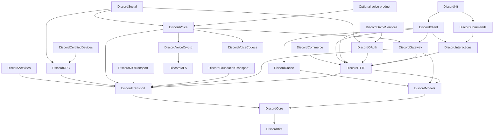

# Architecture and API conventions

Status: adopted design, updated 2026-10-16. `DiscordBits`, `DiscordCore` and
`DiscordTransport` implement the Part 1 foundations; `DiscordKit` exposes common
Core aliases. Part 2 adds independently injected Foundation/NIO adapters, Unix IPC
and Apple lifecycle ownership. Part 3 adds [HTTP execution](HTTP.md), partial Models
and the required [minimal Gateway lifecycle](Gateway.md). Discovery in Gateway
depends on HTTP while the HTTP product remains independent. Part 4 adds separate
[reviewed generation tooling](Generation.md), with committed outputs and no consumer
build-time generator or network access. Part 5A adds the independently adopted
[message/poll REST catalog](RESTCatalog.md), handwritten semantic request/response
contracts, uploads and bounded operation helpers within Models/HTTP. Part 5B adds
[channel/thread contracts](Channels.md) in the same independent products, including
type-aware edits, membership/archive workflows and forum/media creation. Part 5C adds
[guild administration](Guilds.md), typed member/role/ban/settings contracts, explicit
partial bulk outcomes and finite lazy traversal in those same independent products.
Part 5D adds [audit logs and Auto Moderation](Moderation.md), typed audit changes,
validated rule requests and bounded directional audit traversal without adding targets.
Part 5E adds [emoji, stickers and soundboard](Expressions.md), complete written
resource-owned contracts, bounded media and opt-in snapshot reconciliation in Models/HTTP.
Part 5F adds [invites, templates, scheduled events and stages](DiscoveryEvents.md),
with bounded CSV jobs, recurrence/status contracts, finite user traversal and snapshot
reconciliation in the same independent products. Part 5G adds
[applications/users, linked roles and commands](ApplicationsUsers.md), typed profile and
configuration contracts, finite guild traversal and explicit registration reconciliation
without adding dependencies or command-routing targets. Part 5H adds
[webhook/interaction/voice REST contracts](WebhooksInteractionsVoice.md) with typed
path-token scopes. Part 5I adds [monetization contracts](Monetization.md), complete
written SKU/Entitlement/Subscription fields, premium interaction data and finite
traversal in Models/HTTP. Subscription lifecycle state is separate from entitlement
decisions; broader Commerce products remain planned. Part 5J adds
[lobbies and application identity profiles](SocialGame.md), bounded member bulk
workflows and full-replacement profile statistics in the same products.
See [transport contracts](Transport.md). The complete
graph below remains the intended architecture, beyond
the current manifest. Introduce further targets and products with implementations
and tests. See [foundation contracts](Foundation.md) for current scope and limits.

## Product boundaries

Expose a convenient `DiscordKit` composition root while allowing REST, HTTP
interactions, Gateway, OAuth2 and voice to be adopted separately. Product
separation carries these boundaries; mutually exclusive SwiftPM traits do not.

Arrow direction means "depends on." Names are intended target names, except
`VoiceProduct`, which denotes the separately exposed optional voice composition.
Platform adapters are selected and injected at a composition root; protocol
modules do not choose a concrete networking backend.

Owned adapters may depend on approved Apple networking packages or platform
facilities. Their concrete dependency graph must be recorded and qualified before
advertising support. Development generators, documentation audits, fixtures and
test support are separate from public runtime products.

## Responsibilities and invariants

| Layer | Responsibility and boundary |
| --- | --- |
| Bits/Core | Portable value semantics, identifiers, field presence, errors, credentials, redaction and capability descriptions. No live networking. |
| Models | Immutable, `Sendable` Discord payloads and forward-compatible variants. No client, socket or transport references. |
| Transport | Narrow HTTP, WebSocket, datagram, IPC, ingress, stream and lifecycle contracts. Own no Discord endpoint policy. |
| HTTP | Typed service descriptors, authentication policy, codecs, bounded bodies, rate limits, retries and pagination. No Gateway requirement. |
| Gateway | Protocol state, discovery, shards, heartbeats and ordered event production. Does not import cache. |
| Cache | Optional projections of model/event data with explicit freshness, partial state and uncertainty. |
| Interactions/Commands | HTTP-only signature/response lifecycle and complete typed command construction/routing. Commands does not import Client. |
| Client/Kit | Supervised composition, consumer-facing configuration, handlers and service access. |
| Voice | Optional voice/media protocols; narrow Gateway control contracts rather than dependence on the facade. Crypto, MLS and codec work stays isolated. |
| RPC/Activities/Social/Commerce | Distinct local, host, authentication and access contracts; missing wire definitions remain explicit blockers. |

Put a shared protocol in the lowest module that already knows its parameter types.
Do not create an upward dependency just to access a facade convenience. The voice
Gateway edge represents narrow control protocols, not ownership of a bot client.
Portable types may compile on hosts where an operation cannot run; report that
capability separately from protocol implementation status.

## Consumer contract

DiscordKit is designed for bot deployments serving hundreds through millions of
accounts, including deployments with many bot identities. User count, credential
count, guilds, shards and simultaneous connections are distinct capacity axes.
The [scalability requirements](Scalability.md) define request efficiency, identity
isolation, aggregate resource budgets and evidence required for capacity claims.
These are design requirements; current foundations establish no runtime capacity.

REST services use async request methods directly and require no Gateway session.
Bot users configure credentials, intents, handlers and policy, then await a
supervised run operation. The library owns discovery, heartbeats, reconnect/resume,
rate-limit scheduling, serialization and sockets.

HTTP-only applications validate and respond to interactions without loading
Gateway or voice. Command builders expose all supported typed fields and permit
direct typed request construction. Voice consumers join, exchange frames and
leave; the module owns heartbeats, discovery, encryption and media counters.

Expose status, errors and diagnostic hooks without making callers maintain
protocol internals. Diagnostics must redact credentials in headers, paths,
bodies, signed URLs, errors, descriptions, logs, metrics, traces and fixtures.

## Public API conventions

- Use Swift naming and deliberate public access. Prefer immutable `Sendable`
  values, actors for shared mutable runtime state, `async throws` for fallible
  I/O and `AsyncSequence` for asynchronous event subscriptions.
- Keep local computation synchronous. Preserve omitted, explicit null and value
  states in PATCH-style payloads. Preserve unknown fields/variants when the
  documented compatibility contract requires it; never silently narrow large IDs.
- Typed authentication distinguishes bot, bearer, interaction, webhook and
  credential-free operations. Services cannot send API credentials to arbitrary
  origins or CDN requests. Portal setup is documented separately from API calls.
- Specify protocol versions explicitly. The baseline intends
  [REST v10](https://docs.discord.com/developers/reference#api-versioning),
  [Gateway v10](https://docs.discord.com/developers/events/gateway) and
  [Voice Gateway v8](https://docs.discord.com/developers/topics/voice-connections),
  subject to official re-verification before each implementation; these values
  are not current runtime integrations.
- Model permissions, intents, access prerequisites, pagination and retry policy
  per operation. Preserve cancellation and expose an indeterminate mutation
  outcome instead of automatically replaying an ambiguous non-idempotent request.
- Bound subscriptions, queues, frames, bodies and media buffers. Define overflow,
  ordering, close behavior, ownership and cleanup in each public contract.
- Keep raw-route escape hatches within the same authentication, redaction,
  scheduling and origin protections. Raw access does not count as typed parity.
- Every explicitly declared method and test has accurate comprehensive Swift
  documentation and meaningful applicable tests at the time it is introduced.

Rate/cache/coalescing policy belongs above send-once transports. HTTP response
reuse must work without Gateway or the entity-cache product. Shared coordination
is injectable with in-process defaults; shard ownership, Identify admission and
rate reservations cannot silently become independent during coordinator failure.
Start the sharded lifecycle alongside the first HTTP slice, before completing
the endpoint catalog. Measure each runtime milestone against versioned load and
resource budgets in the scalability requirements.

The [concurrency policy](Concurrency.md) supplies execution/ownership rules; the
[parity inventory](Parity/README.md) supplies operation-level evidence. Neither a
diagram nor a public method signature proves supported behavior.
