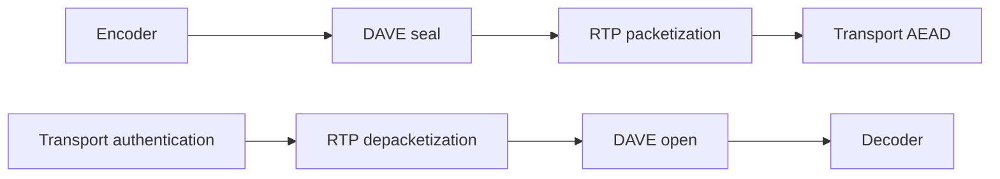

# Independently adopted DAVE

Implemented locally: **2026-10-18**. Official sources verified: **2026-10-18**.
[Validation record](Parity/phase12c-validation.json): final root build, 1,976 strict
tests, tooling/parity checks and the offline VoiceBot passed on macOS arm64.

`DiscordDAVE` implements DAVE wire version **1** over the separately adopted
[MLS 1.0/ciphersuite-2 product](MLS.md). It owns bounded Voice Gateway signaling,
MLS transition coordination, sender key ratchets, encoded-frame encryption and
ephemeral out-of-band verification state. Construction starts no tasks, timers,
sockets, device access or persistence. The application supplies authenticated
Voice controls, participant membership, trusted external-sender identity, a shared
account signing identity and a monotonic clock.

The [official whitepaper](https://daveprotocol.com/) revision and Voice Gateway
**v8** are distinct from negotiated DAVE version 1. The verified official
`libdave` implementation is pinned to
[`8de72b1f8a2ac3c5a5270755bb8091a62e3c6169`](https://github.com/discord/libdave/tree/8de72b1f8a2ac3c5a5270755bb8091a62e3c6169).
[Source fingerprints](Parity/phase12c-current-sources.json) retain exact fetched
bytes, hashes and verification dates. Upstream grouped algorithm introduction and
effective dates are unknown; the local implementation date is separate.

This is an implemented protocol backend, with local deterministic and independent
algorithm evidence. Independent cryptographic review, complete-client/live Discord
interoperability, hardware/platform qualification and the supervised network session
remain open. It does not implement the roadmap's full running voice or video product.

## Dependency and ownership boundaries

The product selects `DiscordMLS`, `DiscordVoice`, `DiscordVoiceCrypto`,
`DiscordCore`, `DiscordTransport` and the existing Swift Crypto/CryptoExtras
products. `DiscordDAVE` depends on Voice; Voice and VoiceCrypto acquire no MLS or
DAVE dependency. HTTP, main Gateway, Client, Cache, OAuth and the umbrella retain
independent adoption. No native Discord SDK, external MLS runtime, codec runtime,
concrete network adapter or new package version is selected.

The caller composes the media flow explicitly:

DAVE transforms one complete encoded frame before packetization and after
depacketization. An RTP fragment cannot be substituted for a frame. Voice v8
socket ownership, heartbeat scheduling, SSRC-to-user routing, network retry and
rejoin deadlines, audio capture/playback and video packetization remain the
supervised-session/codec-provider work in phases 12D/12E. The offline
[VoiceBot consumer](../Examples/VoiceBot/README.md) performs no Discord join.

## Session admission and signaling

`DAVEProtocolSession` binds one actor to a complete `VoiceConnectionIdentity`,
including guild/account/channel/session and local generation, plus an agreed MLS
group ID. For Discord the authenticated call/stream snowflake is represented by
eight big-endian bytes. `signaturePrivateKey` is a valid raw P-256 scalar shared
across related simultaneous media sessions. Recovery preserves that signing
identity while creating fresh HPKE/init keys. Reusing an old media/exporter domain
with a new nonce owner is forbidden.

`start(protocolVersion:)` accepts only version 1 and returns an opcode 26
KeyPackage command. Version zero fails with `downgradeRejected`; unsupported
versions fail closed. The caller delivers authenticated server controls in socket
order through `receive(_:now:)` and sends returned commands once, in order.
There is no automatic retry of an ambiguous KeyPackage, Commit or acknowledgement.
A lost mutation result requires the surrounding connection owner to rejoin.
Participant/proposal admission defaults to 256 members and permits 1–1,024;
Voice frames retain their complete one-MiB envelope bound. Each admitted control
returns a bounded command list, including at most recovery notification plus package.

`DAVESignaling` parses opcodes 11/13 and 21–31 using bounded integer/MLS framing.
The expected participant set comes from authenticated clients-connect/disconnect
controls. External Add/Remove proposals still require the trusted MLS external
sender's signature. An opcode 25 sender must exactly match the application-supplied
credential/key. No untrusted frame can replace that trust anchor.

Opcode 26 uses the whitepaper's MLSMessage-wrapped KeyPackage. Pinned libdave
`Session::GetMarshalledKeyPackage` exposes a bare TLS KeyPackage at its library API
boundary. That helper's output does not establish the complete Voice integration's
wire encoding; no on-wire mismatch has been demonstrated. DiscordKit follows the
normative published wrapper without trying alternate encodings or replaying this
mutation. Complete peer/service interoperability remains unverified.

Before an initial Welcome, the owner retains its KeyPackage and a provisional
epoch-zero group. Cached proposals produce a tentative opcode 28 Commit/Welcome;
the MLS group advances only after delivery-service selection. A validated Commit
or Welcome installs pending receiving ciphers and emits readiness (opcode 23).
Sending stays on the active epoch until execute (opcode 22). Initialization
transition zero activates immediately, including the sole-member epoch-zero case.
Same-epoch protocol transitions retain existing cipher owners and counters.

Invalid selected Commit/Welcome produces opcode 31 followed by a fresh opcode 26
package. Recovery closes prior media/group/package owners and clears ephemeral
verification. Removal, external-sender mismatch, unsupported/downgrade controls,
malformed admitted signaling and unrecoverable errors cannot authorize media.

`authorizeGateway(_:)` returns a copied `VoiceGatewaySessionState` only after the
actor validates a real active epoch and the reducer's exact identity/version.
No reusable readiness token escapes. Subsequent media calls still pass the
session actor's active-epoch and membership checks; a copied ready reducer does
not replace those checks.

One cross-actor control/media operation is admitted at a time; overlapping calls
throw `operationInProgress` without creating an internal queue. Cancellation is
checked before admission, and underlying fallible operations retain their own
checks. `close()` requires the admitted operation to finish, then closes subordinate
owners idempotently without allowing task cancellation to skip cleanup. Snapshots
contain only versions, epoch/transition IDs and bounded counts. Descriptions and
reflection omit identity, frame and key material.

## Sender domains, framing and security limits

For every authenticated epoch/member, the owner exports 16 bytes with label
`Discord Secure Frames v0` and the sender ID encoded as little-endian UInt64.
`DAVEKeyRatchet` applies MLS-style `key`/`secret` DeriveTreeSecret derivation;
generation zero derives from that 16-byte exporter and successors use 32-byte
secrets. Keys are 16-byte AES-128 keys. Discarded prior secrets cannot be rederived.

`DAVEFrameCipher` serializes one transmit counter across all media using the same
sender domain. The first counter is one; every encryption attempt consumes its
counter even if an H26x packetizer collision forces another attempt. The generation
advances every 2^24 counter positions. The synchronization nonce carries the low
32 bits, including generation modulo 256. The full GCM nonce is eight zero bytes
followed by this UInt32 in little-endian order. Absolute generations never exceed
UInt32 and the transmit lifetime is bounded to 2^56−1 counter positions.

The wire frame contains normalized interleaved clear/ciphertext bytes, an eight-byte
AES-128-GCM tag, canonical unsigned LEB128 synchronization nonce and clear-range
offset/length pairs, one-byte supplemental size and marker `FA FA`. The size covers
the entire supplemental section, including size and marker, and cannot exceed 255.
Clear bytes are concatenated in frame order as authenticated additional data;
all remaining encoded bytes are encrypted. Decoding is codec independent and does
not publish candidate plaintext until tag verification succeeds.

Default per-sender policy is:

| Bound | Default | Supported maximum |
| --- | --- | --- |
| Normalized ciphertext plus associated data | 16,384 bytes | 524,288 bytes |
| Actual GCM opens per generation | 2^26 | 2^26 |
| Failed GCM opens per generation | 2^17 | min(total, 2^17) |
| Future ratchet gap | 8 generations | 250 generations |
| Retained generation keys | 16 | 251 |
| Accepted replay window | 1,024 counter positions | 8,192 |
| Old-generation lifetime | 10 seconds | 10 seconds |
| Codec clear ranges | 64 | Wire supplemental size also applies |
| H26x encryption attempts per frame | 10 | 10 |

The frame/verification caps conservatively apply the 64-bit-tag bounds from
[NIST SP 800-38D Appendix C](https://nvlpubs.nist.gov/nistpubs/Legacy/SP/nistspecialpublication800-38d.pdf).
Successful and failed GCM calls count; invalid structure/replay admission does not
perform cryptography. Unauthenticated future-generation attempts retain their
failure accounting within the bounded window and cannot advance the canonical
ratchet or accepted nonce window. Duplicate or stale accepted counters are
rejected. Direct users must share one receive owner or coordinate aggregate
attempt limits when duplicating owners for an exporter/key domain.

AES-GCM is not key committing. The whitepaper records a sophisticated-participant
attack in which a frame can produce different authenticated plaintexts under
different retained transition keys. This known protocol property remains; local
tag/replay tests do not create a stronger commitment guarantee. See the
[cryptographic review packet](MLSCryptoReview.md) for the required review scope.

At most active, pending and one retired epoch are retained per session. A replaced
epoch expires no later than ten monotonic seconds and can be evicted earlier by
another activation. Expiry is driven by injected input timestamps; there is no
background timer. Backward/nonfinite time is rejected. Account-wide limits across
many independent sessions remain the composition owner's responsibility.

There is no plaintext passthrough. `allowOpusSilence` defaults to false and can
permit only the exact `F8 FF FE` SFU-generated audio exception, with explicit audio
context and an admitted current sender. Video never receives that exception.
Transport encryption is independently required and cannot replace DAVE.

## Codec transformations

| Codec | Authenticated clear data and normalization |
| --- | --- |
| Opus | None; encrypt the entire encoded frame |
| VP8 | First 10 bytes for a key frame, first byte for a delta frame |
| VP9 | None; encrypt the entire encoded frame |
| H264 | Canonical four-byte Annex B start codes; ordinary slice NAL header and the bytes covering three Exp-Golomb fields; supported non-VCL metadata stays clear |
| H265 | Canonical four-byte Annex B start codes and two-byte VCL NAL headers; non-VCL NALs stay clear |
| AV1 | OBU header/extension/minimal size; encrypt payloads; discard temporal delimiters, tile lists and padding; omit size on the final retained OBU |

Malformed/truncated framing is rejected. H264 supports ordinary type 1/5 slices
and type 6–16 non-VCL metadata; partitioned/auxiliary/extension slices, reserved
types and RTP aggregate/fragment NAL types are rejected rather than exposed as
clear media. Required Exp-Golomb parsing never crosses a NAL and skips RBSP
emulation-prevention bytes in both prefix and suffix bits. AV1 sizes use at most
eight LEB128 bytes, and the final retained OBU loses its size even when discarded
padding followed it in the source. These fail-closed/normalization rules are
explicit owned behavior beyond the currently pinned libdave malformed-input paths.

H264/H265 ciphertext and supplemental bytes cannot introduce `00 00 01`, including
sequences crossing a clear/cipher boundary. The encryptor checks the entire final
wire frame and retries using a fresh counter, at most ten times. This is a frame
transformation profile; it does not supply video RTP packetizers or decoders.

## Human verification

`DAVEVerification` validates uncompressed P-256 identity keys, sorts the two
version/key/big-endian-user buffers, then derives the 64-byte version-zero
fingerprint using the specified fixed salt and scrypt (N=16,384, r=8, p=2).
The operation performs synchronous CPU work with approximately 16 MiB working
memory. The pure formatter produces a 45-digit pairwise code and 30-digit epoch
code in five-digit groups; applications add spaces/UI themselves.

`DAVEVerificationStore` is optional bounded account-scoped in-memory state shared
by related main-call/Go Live sessions. Defaults are eight sessions and 256 aggregate
distinct identities; supported maxima are 64 and 1,024. Each session ID must be
caller-unique. Only explicit `confirm` after a completed out-of-band comparison
records a verified remote key. A calculated/displayed fingerprint alone does not.
Key changes, disappearance, recovery or disconnect invalidate confirmations;
conflicting local/remote keys across established sessions report inconsistency.
An epoch change with unchanged identity keys preserves confirmation. There is no
persistent identity discovery, secure storage, automatic trust or permission grant.

## Validation and qualification

Swift Testing covers synthetic signaling/MLS peers, epoch ownership, transition
and recovery failures, media wire/tamper/replay/counter limits, malformed codec
structures and verification-state changes. The independently generated Node/OpenSSL
AES-GCM media fixture and pinned ratchet/fingerprint vectors validate external
algorithm bytes. The [codec oracle record](Parity/phase12c-codec-oracle.json) records
eight exact comparisons between production Swift transforms and the unmodified
pinned C++ codec/LEB128 algorithms with minimal collection adapters. That comparison
does not build a complete libdave client or exercise an RTP packetizer.

After changes, run root `swift build`/`swift test`, build and run the offline
VoiceBot, and run inventory/generation/parity checks when their records change.
The [phase execution plan](../.air/plans/phase-12c-execution.plan.md) separates
implementation from qualification. Independent crypto review, compiler/backend
timing review, complete-client interoperability, real Discord handshakes, approved
media smoke, per-platform/minimum-OS device results and ten-minute hardware duplex
remain open. Swift value storage provides logical key teardown without guaranteeing
physical memory erasure. No local result establishes production or fleet capacity.
